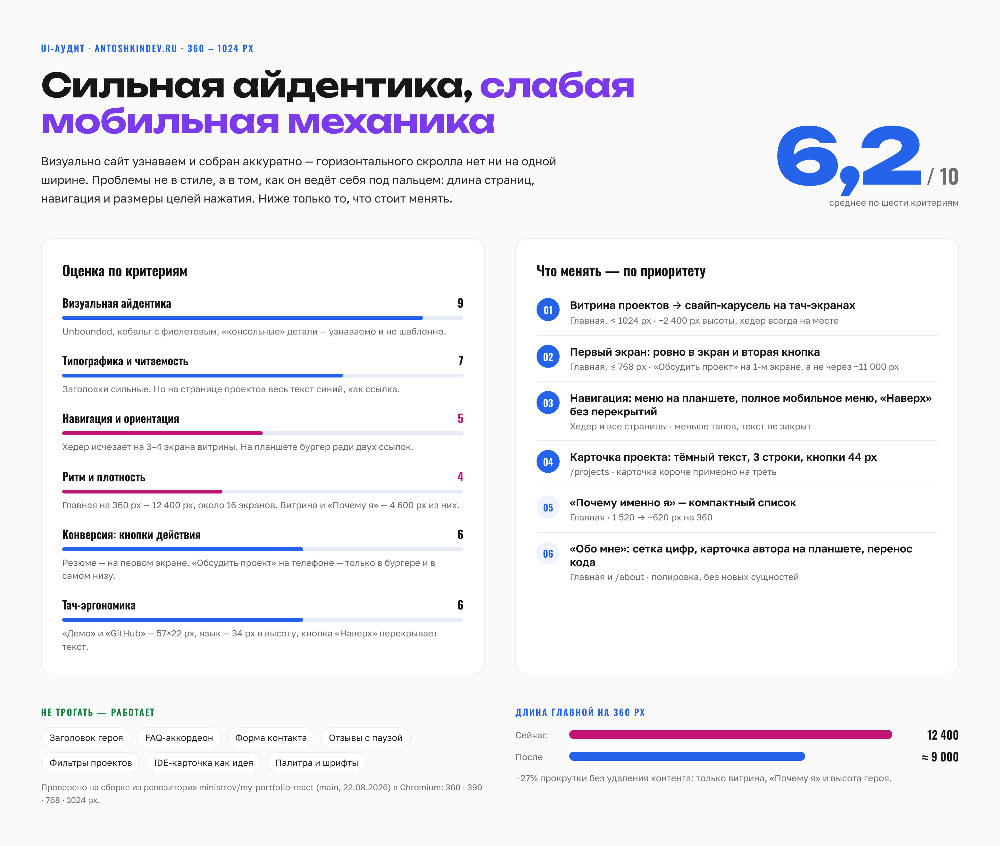
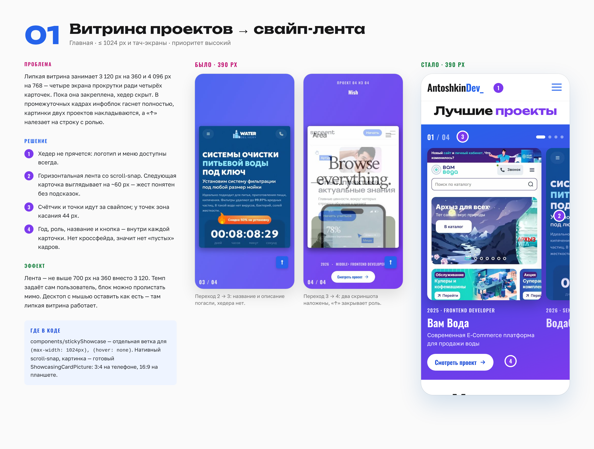
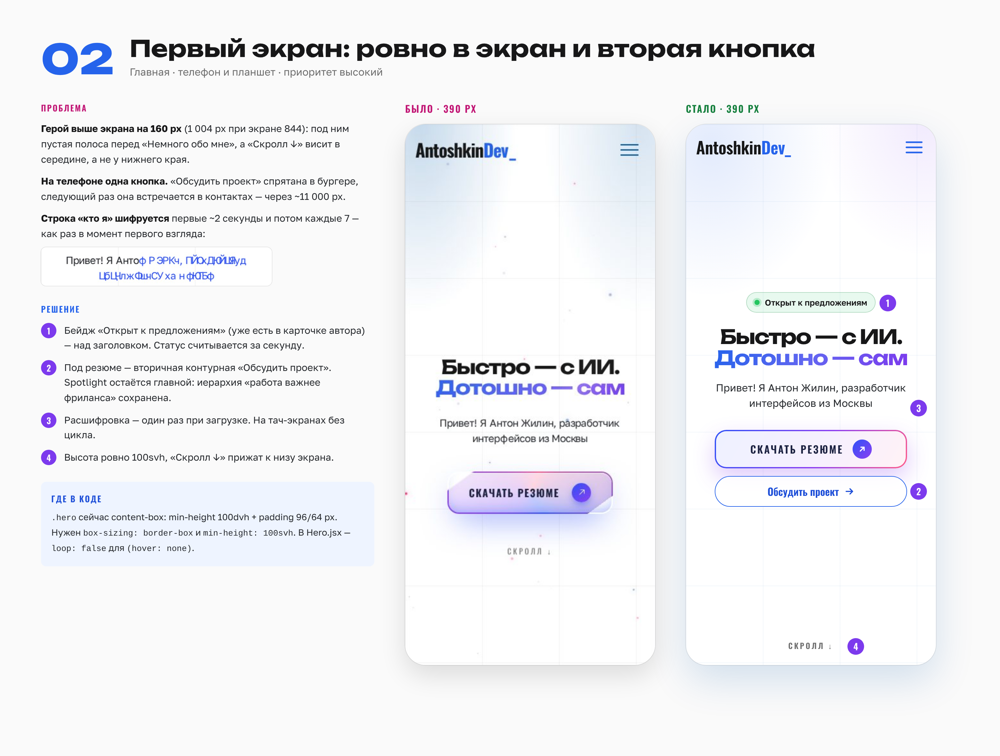
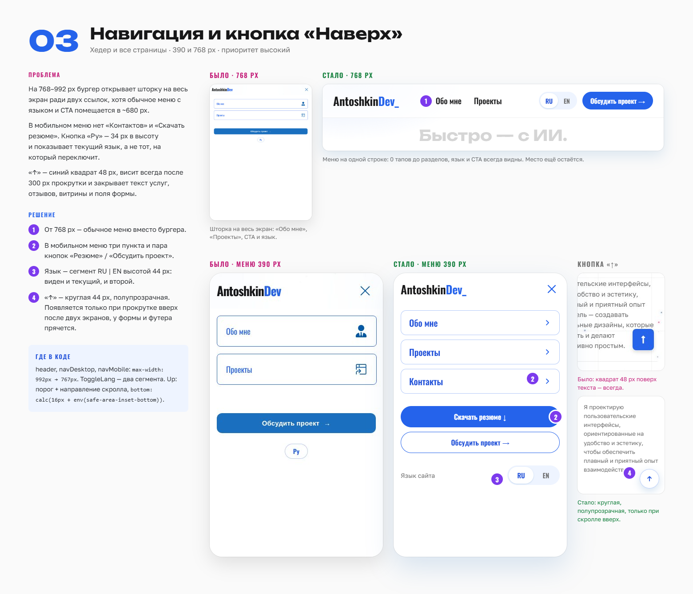
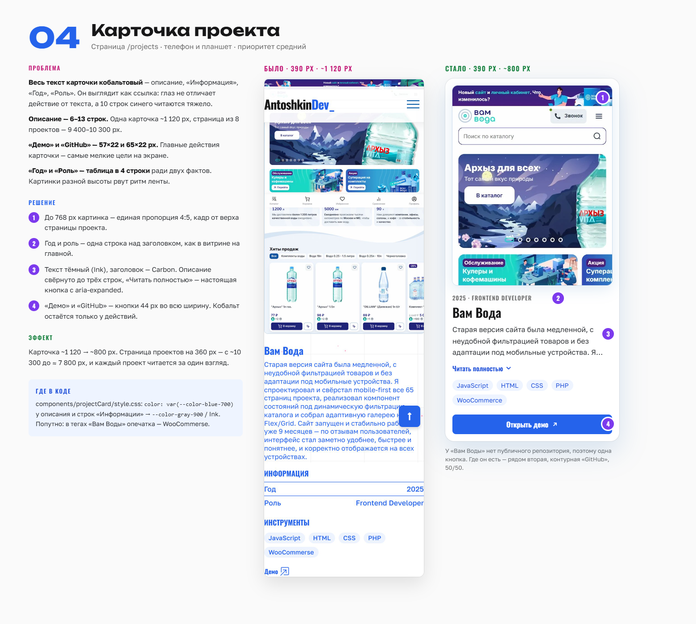
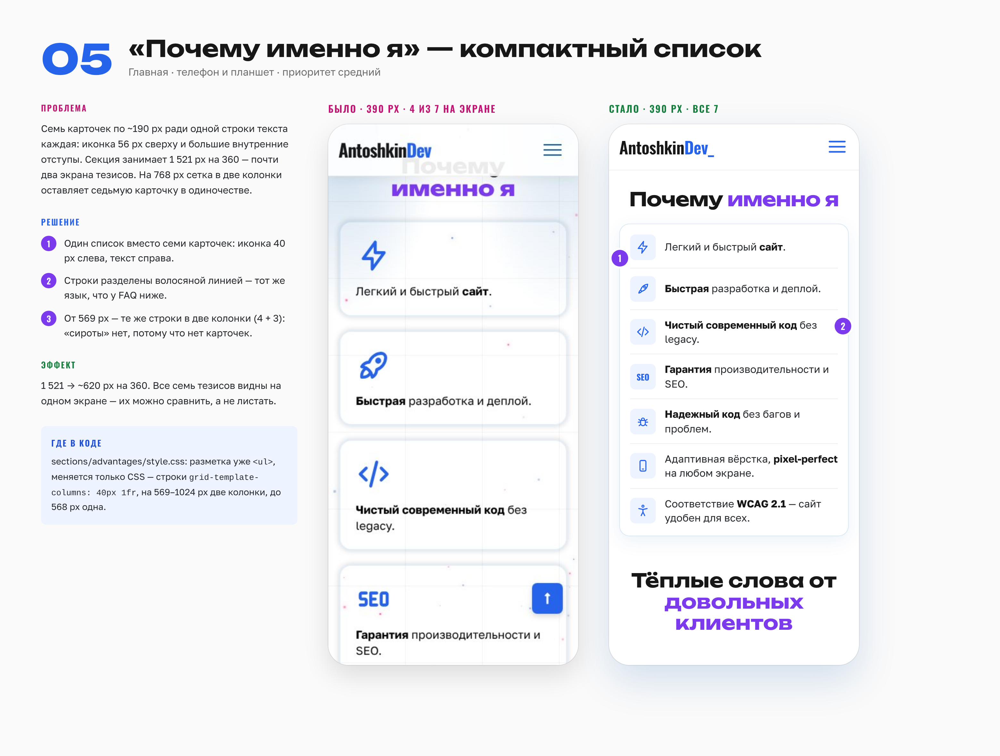
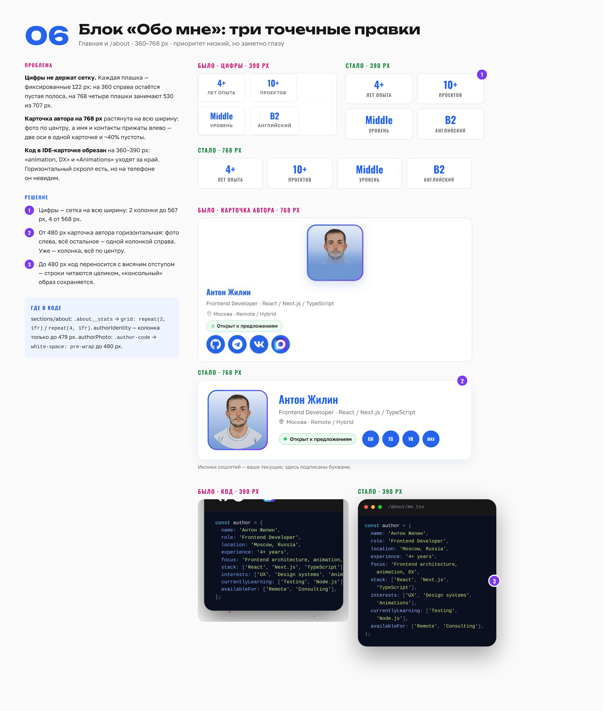

# Спринт UI-улучшений antoshkindev.ru: планшет → мобилка

**Дата:** 15 октября 2026
**Основа:** сборка репозитория `ministrov/my-portfolio-react` (ветка `main`, коммит `edfa758` от 22.08.2026), замеры в Chromium на 360, 390, 768 и 1024 px.
**Как пользоваться:** статус блока меняйте в таблице «Бэклог спринта», критерии приёмки отмечайте в чек-листах `- [ ]` внутри блока.
**Референсы:** PNG-доски аудита лежат в папке `images/` рядом с этим файлом. На каждой доске слева — проблема и решение, в центре — скриншот «было», справа — макет «стало». Фиолетовые цифры на макете соответствуют пунктам «Решение» на самой доске.

**Содержание**

1. Цель и сводная оценка
2. Блок 01 · Витрина проектов → свайп-лента
3. Блок 02 · Первый экран
4. Блок 03 · Навигация и кнопка «Наверх»
5. Блок 04 · Карточка проекта
6. Блок 05 · «Почему именно я» — компактный список
7. Блок 06 · Блок «Обо мне»
8. Календарь, Definition of Done и регрессия

---

## Цель и сводная оценка

За один двухнедельный спринт (26 SP, 41–55 часов чистой работы) мобильная и планшетная версии перестают терять пользователя: хедер всегда доступен, главная на 360 px короче примерно на 27%, а все цели нажатия, которые затрагивает спринт, не меньше 44 px. Десктоп от 1025 px с мышью визуально не меняется — кроме цвета текста в карточках проектов (блок 04).

*Доска 00 · Оценка по шести критериям, список правок по приоритету и длина главной до и после.*

### Метрики успеха

| Метрика | Сейчас | Цель | Как мерить |
| --- | --- | --- | --- |
| Высота главной, 360×780 | 12 400 px | ≤ 9 200 px | `document.documentElement.scrollHeight` в DevTools |
| Высота /projects, 360×780 | ~10 300 px | ≤ 8 000 px | то же |
| Хедер виден при прокрутке, ≤ 1024 px | скрыт на 3–4 экрана витрины | всегда | ручная прокрутка главной |
| Цели нажатия, которые меняет спринт, 360–1024 px | «Демо» 57×22, «GitHub» 65×22, язык в меню 34 px в высоту | ≥ 44×44 px | DevTools → размеры элементов |
| Lighthouse mobile, Accessibility | замерить в день 1 | ≥ 95 | Lighthouse, режим Mobile |
| Lighthouse mobile, Performance | замерить в день 1 | не ниже исходного | то же |

**Вне спринта — мелкие цели нажатия.** Замер нашёл ещё элементы меньше 44 px, которые этот спринт не трогает: логотип (34 px в высоту), ссылка «Больше обо мне» (95×20), копирование email (215×22), «Как происходит заказ? →» (192×18), хлебные крошки (49×20), соцсети в IDE-карточке на /about (40×40). Кандидаты в следующий спринт.

### Бэклог спринта

| Блок | Приоритет | SP | Оценка, ч | Риск | Статус |
| --- | --- | --- | --- | --- | --- |
| 01 · Витрина → свайп-лента | P1 | 8 | 12–16 | Высокий | Не начато |
| 02 · Первый экран | P1 | 3 | 5–7 | Низкий | Не начато |
| 03 · Навигация и «Наверх» | P1 | 5 | 10–13 | Средний | Не начато |
| 04 · Карточка проекта | P2 | 5 | 7–9 | Низкий | Не начато |
| 05 · «Почему именно я» | P2 | 2 | 3–4 | Низкий | Не начато |
| 06 · «Обо мне» | P3 | 3 | 4–6 | Низкий | Не начато |
| **Итого** |  | **26** | **41–55** |  |  |

Шкала: 1 SP ≈ 1,5–2 часа в этой кодовой базе. В оценку входят код, юнит-тесты на Vitest, ручная проверка на нужных ширинах, правки ru/en-словарей и запись в `CHANGELOG.md`. Ёмкость спринта — примерно 4–5 сфокусированных часов в рабочий день, 10 рабочих дней, то есть 40–50 часов. Буфер ~15% заложен в верхнюю границу диапазона.

Обязательство спринта — блоки 01–05 (23 SP, 37–49 ч). Блок 06 — stretch-цель: он переносится в следующий спринт, если ёмкость окажется ближе к 4 часам в день.

Каждый блок ниже устроен одинаково: паспорт → референс → user story → почему → scope → гайд по шагам → критерии приёмки (сначала из user story, потом технические) → проверка → оценка → риски.

<!-- ═══════════════════════════════════════════════════════════════════ -->

---

## Блок 01 · Витрина проектов → свайп-лента

> **Приоритет:** P1 · **SP:** 8 · **Оценка:** 12–16 ч · **Риск:** высокий · **Зависимости:** нет; даёт хук `useMediaQuery` блокам 02 и 03 (если 02 идёт первым — хук создаётся там)

На экранах до 1024 px и на тач-устройствах липкая витрина заменяется горизонтальной лентой на CSS scroll-snap. Десктоп с мышью сохраняет нынешнюю липкую витрину.

### Референс

*Доска 01 · В центре — два промежуточных кадра нынешней витрины на 390 px, справа — свайп-лента. Цифры 1–4 на макете — пункты «Решение» на доске.*

**User story.** Как рекрутер с телефона, я листаю лучшие проекты свайпом, не теряю меню и вижу, сколько всего проектов и на каком я сейчас. Так я за минуту оцениваю работы, открываю интересный проект и иду дальше по странице.

**Почему.** Блок витрины (`.sticky-showcase`) сейчас занимает 3 120 px на 360 и 4 096 px на 768. Пока он закреплён, хедер скрыт классом `sticky-showcase-pinned` на `<body>`. В промежуточных кадрах инфоблок гаснет полностью, картинки двух проектов накладываются, а кнопка «↑» закрывает строку с ролью.

### Scope

- **Входит:** новая ветка рендера для `(max-width: 1024px), (hover: none)`, компонент ленты, счётчик и точки, ключи ru/en, тесты.
- **Не входит:** липкая витрина для десктопа, фолбэк `prefers-reduced-motion` (остаётся как есть), содержимое `projects.js`.

### Гайд по шагам

1. **Хук `useMediaQuery`.** Создать `src/hooks/useMediaQuery.jsx`: `matchMedia(query)`, подписка на событие `change`, отписка в cleanup. Начальное значение — синхронно из `matchMedia(query).matches`, чтобы не было мигания. JSDoc на русском.
2. **Ветвление в `StickyShowcase.jsx`.** Вверху компонента: `const isTouchLayout = useMediaQuery('(max-width: 1024px), (hover: none)')`. Порядок веток рендера: пусто → reduced motion → `isTouchLayout` → липкая витрина.
    - В `useLayoutEffect` со слушателем скролла добавить `isTouchLayout` в условие раннего выхода. Иначе слушатель продолжит считать прогресс, а класс `sticky-showcase-pinned` — появляться на `<body>`.
    - Хуки не переносить под условия: все вызовы остаются над первым `return`.
3. **Компонент `ShowcaseCarousel`.** Папка `src/components/showcaseCarousel/` с `ShowcaseCarousel.jsx` и `style.css`. Данные — тот же `projects.filter((item) => item.isBest)`.
    - Разметка по паттерну карусели WAI-ARIA: `
` → трек `
` → слайды `
`. Списки `ul`/`li` здесь не использовать: `role="group"` на `li` ломает семантику списка.
    - Внутри слайда: `ShowcasingCardPicture`, строка «год · роль», `<h3>` с названием, слоган, `<Link>` «Смотреть проект» на `/projects#project-{id}`. Ссылку не растягивать на всю карточку: при свайпе по растянутой ссылке бывают случайные переходы.
4. **CSS ленты** (BEM, без inline-стилей, desktop-first). Компонент рендерится только на ≤ 1024 px, поэтому базовые стили — планшетные, а телефон — в `@media (max-width: 767px)`.
    - Трек: `position: relative; display: flex; gap: 12px; overflow-x: auto; scroll-snap-type: x mandatory; scroll-padding-inline: 16px; padding-inline: 16px; overscroll-behavior-x: contain; scrollbar-width: none`, плюс `::-webkit-scrollbar { display: none }`.
    - Слайд (768–1024 px): `flex: 0 0 min(520px, 72%); scroll-snap-align: start`.
    - Слайд (≤ 767 px): `flex-basis: calc(100% - 56px); max-width: 340px` — следующая карточка выглядывает примерно на 60 px.
    - Картинка: `object-fit: cover; object-position: top`. Пропорция — по исходникам, которые отдаёт `ShowcasingCardPicture`: `aspect-ratio: 16 / 9` на 768–1024 px (tablet-обложки 938×528) и `aspect-ratio: 3 / 4` на ≤ 767 px (mobile-обложки 578×771). Брейкпоинт 767/768 совпадает с `<source media>` в компоненте.
    - Фон добавлять не нужно: градиент уже задан у обёртки `.showcasing__wrapper` (`var(--gradient), var(--color-blue-700)`).
5. **Счётчик и точки.** `IntersectionObserver` с `root` = трек и `threshold: 0.6` на каждый слайд; видимый слайд пишет свой индекс в `useState`. Клик по точке: `track.scrollTo({ left: slide.offsetLeft - 16, behavior })`. `offsetLeft` считается от трека, потому что у него `position: relative`; `behavior` = `'auto'` при reduced motion, иначе `'smooth'`. Точка рисуется 8 px, а зона касания 44×44 — через `padding` или `::before`. Активной точке — `aria-current="true"`, счётчику — `aria-hidden="true"`.
6. **i18n.** Новые ключи в `ru.json` и `en.json`: `showcasing.carouselLabel` и `showcasing.slideLabel` с параметрами `{{current}}`, `{{total}}`, `{{project}}`. Существующие ключи `showcasing.eyebrow`, `showcasing.viewProject` и `showcasing.dotAriaLabel` переиспользовать.
7. **Тесты.**
    - `useMediaQuery.test.jsx` — мок `window.matchMedia`, переключение значения по событию `change`.
    - `ShowcaseCarousel.test.jsx` — 4 слайда, подписи слайдов, клик по точке вызывает `scrollTo` с нужным `left`.
    - В jsdom нет `IntersectionObserver` — мок в `src/setupTests.js`.
8. **Документация.** В `DESIGN.md` в раздел Components — абзац о ленте на тач-экранах; в `CHANGELOG.md` — запись.

**Альтернатива шагам 4–5** — Swiper, он уже в зависимостях. `Showcasing` и `Testimonials` грузятся лениво, так что Swiper попадёт в общий чанк, а не в `index`. Нативный scroll-snap всё равно предпочтительнее: даёт системную инерцию на iOS и не добавляет JS.

### Критерии приёмки

**Из user story**

- [ ] На ≤ 1024 px и на тач-устройствах витрина — горизонтальная лента, которая листается свайпом.
- [ ] Свайп переключает ровно одну карточку; на ≤ 767 px следующая выглядывает не меньше чем на 40 px.
- [ ] Хедер виден на всём проходе через секцию; класс `sticky-showcase-pinned` на `<body>` не появляется.
- [ ] Счётчик «01 / 04» и активная точка совпадают с видимой карточкой после свайпа и после нажатия на точку.
- [ ] «Смотреть проект» открывает `/projects` и прокручивает к нужной карточке.
- [ ] Высота `.showcasing__wrapper` на 360 px ≤ 700 px (сейчас 3 120 px) — витрину можно пролистать мимо за один жест.

**Технические**

- [ ] Точки — `<button>` с зоной касания ≥ 44×44 px и подписью «Перейти к проекту …».
- [ ] Tab по ссылкам «Смотреть проект» сам прокручивает ленту к карточке в фокусе, фокус-кольцо видно.
- [ ] При `prefers-reduced-motion: reduce` — статичный список, как сейчас.
- [ ] На ≥ 1025 px с мышью липкая витрина работает без изменений.
- [ ] Чанк `Showcasing` вырос не больше чем на 3 КБ gzip.

### Проверка

- Ширины: 360, 390, 767, 768, 1024 (портрет iPad Pro), 1280.
- Устройства: iOS Safari и Chrome Android, хотя бы по одному реальному.
- Поворот планшета 768 ↔ 1024 без перезагрузки: ветка рендера меняется, прокрутка не прыгает, на `<body>` нет лишнего класса.
- Свайп от левого края экрана на iOS не запускает «назад» браузера.

### Оценка

| Задача | Часы |
| --- | --- |
| Хук `useMediaQuery` и тест | 1–1,5 |
| Ветвление `StickyShowcase`, отключение липкой логики | 1 |
| `ShowcaseCarousel`: разметка, scroll-snap, CSS | 4–5 |
| Счётчик и точки: `IntersectionObserver`, `scrollTo` | 2–3 |
| Доступность: роли, подписи, фокус, reduced motion | 1–1,5 |
| Ключи ru/en | 0,5 |
| Тесты компонента | 1,5–2 |
| Проверка на шести ширинах и двух устройствах, правки | 1–1,5 |
| **Итого** | **12–16** |

**Риски.**

- Смена ветки при повороте планшета: снятие класса с `<body>` уже есть в cleanup эффекта — проверить, что он срабатывает при переключении ветки.
- Вертикальный скролл страницы поверх горизонтального трека на iOS: `touch-action` не трогать, браузер разводит жесты сам.

<!-- ═══════════════════════════════════════════════════════════════════ -->

---

## Блок 02 · Первый экран

> **Приоритет:** P1 · **SP:** 3 · **Оценка:** 5–7 ч · **Риск:** низкий · **Зависимости:** хук `useMediaQuery` (блок 01); вторая кнопка скрывается на ≥ 768 px, потому что после блока 03 там видна кнопка в хедере

Герой становится ровно в экран, получает бейдж статуса и вторую кнопку на телефонах, а строка «кто я» перестаёт шифроваться по кругу на тач-экранах.

### Референс

*Доска 02 · В центре — нынешний первый экран на 390 px, справа — целевой: бейдж, две кнопки, «Скролл ↓» у нижнего края. Цифры 1–4 на макете — пункты «Решение» на доске.*

**User story.** Как посетитель с телефона, я за первые секунды вижу, кто это и что он открыт к предложениям, и могу сразу скачать резюме или перейти к обсуждению проекта. Подсказка у нижнего края экрана показывает, что ниже есть продолжение.

**Почему.** Секция `.hero` сейчас считается как `content-box`: `min-height: 100dvh` плюс отступы 96 и 64 px дают 1 004 px при экране 844 (на 360×780 — 940 px). На телефоне видна одна кнопка: «Обсудить проект» спрятана в бургере, а следующий раз встречается в контактах — через ~11 000 px. Подзаголовок с `loop: true` после каждой 7-секундной паузы снова превращается в набор случайных букв.

### Scope

- **Входит:** высота героя, бейдж, контурная вторая кнопка до 767 px, расшифровка без цикла на тач-экранах.
- **Не входит:** текст заголовка, spotlight-кнопка «Скачать резюме» и её анимации, десктопный вид героя.

### Гайд по шагам

1. **Высота.** В `src/sections/hero/style.css` у `.hero`: `box-sizing: border-box`, затем `min-height: 100vh` как фолбэк и `min-height: 100svh` вместо `100dvh`. `svh` не пересчитывается, когда панель Safari схлопывается, — блок не прыгает при скролле.
2. **«Скролл ↓» у нижнего края.**
    - Перенести `
` из `.hero__inner` прямо в `<section className="hero">`: у `.hero__inner` стоит `position: relative`, и абсолютное позиционирование считалось бы от него.
    - Стиль: `position: absolute; left: 0; right: 0; bottom: calc(16px + env(safe-area-inset-bottom)); margin: 0; text-align: center`.
    - Центрировать именно так, а не через `translateX(-50%)`: `transform` уже занят анимацией `hero-scroll-bounce` (`translateY`).
3. **Бейдж статуса.**
    - Вынести разметку `.author-meta__available` из `AuthorMeta.jsx` в компонент `src/components/availabilityBadge/AvailabilityBadge.jsx` со своим `style.css` — по BEM элемент чужого блока не переиспользуют.
    - Проп `variant: 'light' | 'dark'`: стили из `.author-meta--dark .author-meta__available` переезжают в модификатор `.availability-badge--dark`. `AuthorMeta` передаёт свой `variant`, герой — `light`.
    - Подключить в `Hero` над `<h1>`. Ключ перевода прежний: `about.available`.
    - Появление — тем же `m.div`/`titleMotion`, что и у заголовка, без сдвига макета.
4. **Вторая кнопка.**
    - В `src/components/ctaButton/style.css` добавить вариант `.cta-button--outline`: прозрачный фон, рамка 1,5 px кобальтом, текст кобальтом, высота 48 px, pill; на наведение — фон Frost (`var(--color-gray-200)`).
    - В `Hero.jsx` в `.hero__actions` после `.hero__btn-col`: `<CtaButton variant="outline" className="hero__secondary-cta" />`. Подпись по умолчанию берётся из `modal.cta` («Обсудить проект»), клик уже плавно прокручивает к `.contact`.
    - `.hero__secondary-cta { display: none }`, а в `@media (max-width: 767px)` — `display: flex`.
    - `.hero__actions` до 767 px: `flex-direction: column; gap: 12px; width: min(300px, 100%)`.
5. **Расшифровка.** В `Hero.jsx`: `const isTouch = useMediaQuery('(hover: none)')` и `loop: !isTouch` в опциях `useScrambleText`. Первая расшифровка при загрузке остаётся — это часть подписи сайта.
6. **Тесты.**
    - `CtaButton.test.jsx` — класс `cta-button--outline` и вызов `scrollIntoView` по клику.
    - `AvailabilityBadge.test.jsx` — текст из ключа в обеих локалях, модификатор `--dark`.

### Критерии приёмки

**Из user story**

- [ ] Бейдж «Открыт к предложениям» стоит над заголовком.
- [ ] До 767 px под «Скачать резюме» есть контурная «Обсудить проект» высотой 48 px, она плавно ведёт к контактам.
- [ ] На 360×780 без прокрутки видны бейдж, заголовок, подзаголовок и обе кнопки.
- [ ] На тач-устройствах подзаголовок расшифровывается один раз и дальше читается; на десктопе — как сейчас.
- [ ] «Скролл ↓» стоит у нижнего края экрана и не заходит под домашний индикатор iPhone.

**Технические**

- [ ] На 360×780 и 390×844 высота `.hero` равна высоте экрана (±1 px), пустой полосы перед «Немного обо мне» нет.
- [ ] Spotlight-кнопка остаётся визуально главной; на ≥ 768 px вторая кнопка в герое не показывается.
- [ ] Бейдж в карточке автора (светлой на главной и тёмной на /about) выглядит как раньше.
- [ ] CLS первого экрана в Lighthouse не вырос.

### Проверка

- Ширины 360, 390, 767, 768; на реальном iOS Safari — с развёрнутой и свёрнутой панелью адреса.
- Альбомная ориентация телефона (844×390): контент выше экрана — блок растёт, подсказка не наезжает на кнопки.
- `prefers-reduced-motion`: бейдж без пульсации, подзаголовок сразу текстом.

### Оценка

| Задача | Часы |
| --- | --- |
| `box-sizing`, `svh`, перенос подсказки | 0,5–1 |
| `AvailabilityBadge`: вынос из `AuthorMeta`, варианты, подключение в героя | 1–1,5 |
| Вариант `outline` и вёрстка пары кнопок | 1–1,5 |
| Расшифровка без цикла на тач-экранах | 0,5 |
| Тесты | 1 |
| Проверка на iOS Safari и четырёх ширинах | 1–1,5 |
| **Итого** | **5–7** |

**Риски.**

- `svh` нет в Safari старше 15.4 — строка `min-height: 100vh` перед ним закрывает это.
- Если блок 02 делается раньше блока 01, хук `useMediaQuery` создаётся здесь, а блок 01 его переиспользует.

<!-- ═══════════════════════════════════════════════════════════════════ -->

---

## Блок 03 · Навигация и кнопка «Наверх»

> **Приоритет:** P1 · **SP:** 5 · **Оценка:** 10–13 ч · **Риск:** средний · **Зависимости:** хук `useMediaQuery` (блок 01), вариант `cta-button--outline` (блок 02)

От 768 px хедер показывает обычное меню. На телефоне в меню появляются недостающие пункты и понятный переключатель языка, а «↑» перестаёт перекрывать контент.

### Референс

*Доска 03 · Сверху — хедер на 768 px (было и стало), ниже — мобильное меню на 390 px и кнопка «↑». Цифры 1–4 на макетах — пункты «Решение» на доске.*

**User story.** Как посетитель с планшета или телефона, я попадаю в любой раздел и к контактам за один-два тапа и сразу понимаю, на какой язык переключусь. Текст я читаю без плавающих кнопок поверх него.

**Почему.**

- На 768–992 px бургер открывает шторку на весь экран ради двух ссылок.
- В мобильном меню нет «Контактов» и резюме.
- Кнопка «Ру» высотой 34 px показывает текущий язык, а не тот, на который переключит.
- «↑» — синий квадрат 48 px, виден всегда после 300 px прокрутки и накрывает текст услуг, отзывов, витрины и поля формы.

### Scope

- **Входит:** брейкпоинт меню, состав мобильного меню, `ToggleLang`, поведение и вид `Up` на ≤ 1024 px.
- **Не входит:** `LanguageProvider` и логика `?lang=` — их не трогаем, `src/utils/lang.test.js` должен остаться зелёным; десктопный вид «↑».

### Гайд по шагам

1. **Брейкпоинт меню.** Заменить `max-width: 992px` на `max-width: 767px` в правилах, которые прячут десктопную навигацию и показывают бургер:
    - `src/layouts/header/style.css` — скрытие `.header__actions > .cta-button` и `.header__actions > .nav__lang`;
    - `src/components/navDesktop/style.css` — скрытие `.nav-list` и `.nav__lang`;
    - `src/components/navMobile/style.css` — показ `.nav-mobile`.
    - Отступы хедера и `--header-height: 81px` оставить на 992 px.
    - Для 768–992 px новый медиазапрос не нужен: внутри существующего `max-width: 992px` ужать `.header__actions` (`gap: 0.75rem`) и CTA (`padding-inline: 16px`, шрифт 15 px).
    - Если ссылки меню или CTA на 768–1024 px ниже 44 px — добавить им `min-height: 44px` с `display: inline-flex; align-items: center`.
    - Проверить английскую локаль: «About», «Projects» и «Discuss a project» в сумме длиннее русских подписей.
2. **Автозакрытие меню.** В `Header.jsx`: `const isWide = useMediaQuery('(min-width: 768px)')` и эффект `if (isWide) handleMenuClose()`. Иначе при повороте планшета открытая шторка останется висеть с заблокированным скроллом (`useBodyScrollLock`).
3. **Состав мобильного меню** (`src/components/navMobile/MobileMenu.jsx`).
    - «Контакты» — не в `routes` (иначе пункт появится и в десктопном меню как `NavLink`), а отдельным `<li>` после маршрутов.
    - Разметка — `<a href="#contact-heading">`. У заголовка контактов уже есть `id="contact-heading"`, а правило `[id$='-heading'] { scroll-margin-top: var(--header-height) }` в `main.css` не даст ему уйти под хедер — новый `id` не нужен.
    - В `onClick`: `preventDefault()`, `onClose()`, затем в `requestAnimationFrame` — `document.getElementById('contact-heading')?.scrollIntoView({ behavior })`. Это тот же приём, что в `CtaButton`, и из меню он уже работает.
    - Секция контактов есть на главной, /about и /projects, поэтому переход между роутами не нужен.
    - В `.nav-mobile__footer` две кнопки. Первая — «Скачать резюме»: `<a href={cvPdf} download="Anton_Zhilin_CV.pdf">` с заливкой кобальтом, файл `src/assets/pdfs/my-cv.pdf`, как в герое. Вторая — «Обсудить проект»: `CtaButton variant="outline"` из блока 02. Резюме стоит первым: работа важнее фриланса (PRODUCT.md, принцип 2).
    - Ключи: новый `mainNav.contacts` («Контакты» / «Contacts»); для резюме переиспользовать `hero.btn`.
4. **Переключатель языка.**
    - `ToggleLang` становится группой `
` из двух `<button aria-pressed>`: RU и EN.
    - Клик по неактивной кнопке вызывает прежний `toggleLang()`, по активной — ничего. Контекст языка при этом не меняется вообще.
    - Высота группы 44 px на ≤ 767 px и 40 px в хедере; фон Frost, активный сегмент — белый с тенью Cobalt Shadow (`rgba(0, 88, 167, …)`).
5. **Кнопка «↑»** (`src/components/Up/Up.jsx`), только для `(max-width: 1024px)` через `useMediaQuery`.
    - В `handleScroll` хранить прошлый `scrollY` в `useRef`. Показывать кнопку, если `scrollY > 2 * innerHeight` и прокрутка идёт вверх; скрывать при прокрутке вниз. Реагировать на сдвиг больше 8 px, а не на каждый пиксель.
    - `IntersectionObserver` на `.contact-form` и `.main-footer`: пока они в кадре, кнопка скрыта. Элементы лежат в других компонентах, поэтому `querySelector` допустим — так же сделано в `CtaButton`.
    - Вид на ≤ 1024 px: круг 44 px, фон `rgba(255, 255, 255, 0.8)` с `backdrop-filter: blur(8px)`, рамка `rgba(37, 99, 235, 0.3)`, иконка кобальтом, `bottom: calc(16px + env(safe-area-inset-bottom))`, `right: 16px`.
    - Появление и исчезновение — opacity и сдвиг на 8 px за 200 мс; при reduced motion без перехода.
6. **Тесты.**
    - `ToggleLang.test.jsx` — `aria-pressed` у текущего языка; клик по активному не вызывает `toggleLang`.
    - `Up.test.jsx` — последовательность `scrollY` вниз и вверх и видимость кнопки.
    - `MobileMenu.test.jsx` — три пункта, ссылка на резюме, закрытие меню по «Контактам».

### Критерии приёмки

**Из user story**

- [ ] На 768–1024 px в хедере одной строкой: логотип, «Обо мне», «Проекты», переключатель языка, «Обсудить проект»; бургера нет.
- [ ] До 767 px в меню: «Обо мне», «Проекты», «Контакты», «Скачать резюме», «Обсудить проект», переключатель языка.
- [ ] «Контакты» закрывает меню и прокручивает к контактам на главной, /about и /projects; заголовок секции не уходит под хедер.
- [ ] Язык — две кнопки RU/EN, текущий язык отмечен (`aria-pressed`), высота ≥ 44 px на телефоне.
- [ ] «↑» на ≤ 1024 px: круг 44 px, появляется только при прокрутке вверх после двух экранов и скрыта, пока в кадре форма контакта или футер.

**Технические**

- [ ] На 768 px в хедере ничего не переносится и не обрезается в обеих локалях; ссылки и CTA не ниже 44 px.
- [ ] При повороте до ≥ 768 px открытое меню закрывается, скролл разблокирован.
- [ ] `?lang=` и localStorage работают как раньше, `src/utils/lang.test.js` зелёный.
- [ ] На ≥ 1025 px хедер и «↑» выглядят и ведут себя как раньше.

### Проверка

- Ширины 360, 390, 767, 768, 992, 1024 — в обеих локалях.
- Клавиатура: Tab по хедеру на 768 px, фокус в открытом меню, Esc закрывает его и возвращает фокус на бургер.
- `npm run test:run` — все тесты зелёные.

### Оценка

| Задача | Часы |
| --- | --- |
| Брейкпоинт 992 → 767 в трёх файлах, компактный хедер на 768–992 | 2 |
| Мобильное меню: «Контакты», резюме, автозакрытие | 2–2,5 |
| `ToggleLang` → сегмент RU/EN | 1,5–2 |
| `Up`: направление скролла, `IntersectionObserver`, новый вид | 2–3 |
| Тесты трёх компонентов | 1,5–2 |
| Проверка ru/en на шести ширинах, клавиатура | 1–1,5 |
| **Итого** | **10–13** |

**Риски.**

- Английские подписи могут не влезть в 768 px. Запасной вариант: на 768–860 px скрыть стрелку в CTA или укоротить подпись.
- Поведение «↑» по направлению скролла может дёргаться на инерционной прокрутке iOS — порог 8 px это гасит; проверить на реальном устройстве.

<!-- ═══════════════════════════════════════════════════════════════════ -->

---

## Блок 04 · Карточка проекта

> **Приоритет:** P2 · **SP:** 5 · **Оценка:** 7–9 ч · **Риск:** низкий · **Зависимости:** нет

Текст карточки становится тёмным на всех ширинах. На ≤ 1024 px карточка собирается компактнее: строка «год · роль», описание в три строки и кнопки по 44 px.

### Референс

*Доска 04 · В центре — нынешняя карточка «Вам Воды» целиком (~1 120 px), справа — компактная (~800 px). Цифры 1–4 на макете — пункты «Решение» на доске.*

**User story.** Как рекрутер, я пролистываю /projects на телефоне, легко читаю описание и за пару секунд понимаю, что это за проект, какой год и какая роль. Подробности я раскрываю, если заинтересовался, а демо открываю с первого нажатия.

**Почему.** В `src/components/projectCard/style.css` у заголовка, описания, подзаголовков и таблицы стоит `color: var(--color-blue-700)`, и весь текст выглядит как ссылка. Описание — 6–13 строк на телефоне, карточка занимает ~1 120 px. «Демо» и «GitHub» — текстовые ссылки 57×22 и 65×22 px.

### Scope

- **Входит:** цвета на всех ширинах — единственная правка спринта, которая осознанно задевает десктоп. На ≤ 1024 px — мета-строка, свёртка описания и кнопки; на ≤ 768 px — единая пропорция картинки. Опечатка в `projects.js`.
- **Не входит:** раскладка карточки на ≥ 1025 px, фильтры, тексты описаний.

### Гайд по шагам

1. **Цвета** (`src/components/projectCard/style.css`):
    - `.project-card__info-title` → `var(--color-gray-900)` (Carbon);
    - `.project-card__info-desc`, `dt`, `dd` → `var(--color-gray-800)` (Ink);
    - `.project-card__info-box h4` и `.project-card__tools-title` → Carbon;
    - линии таблицы — `1px solid rgba(0, 0, 0, 0.08)` вместо кобальта.
2. **Мета-строка.**
    - В `ProjectCard.jsx` над `<h3>`: `
{year}{role}
` с разделителем-точкой через `::after`, как у `.sticky-showcase__meta`.
    - Типографика — Label из DESIGN.md: Oswald 700, 0.75rem, `letter-spacing: 0.09em`, uppercase; цвет Graphite `var(--color-gray-500)`.
    - На ≥ 1025 px `.project-card__meta { display: none }`; на ≤ 1024 px скрыть `.project-card__info-box`. Оба блока прячутся через `display: none`, поэтому скринридер не прочитает дубль.
3. **Свёртка описания** (только ≤ 1024 px).
    - CSS: `.project-card__info-desc--clamped { display: -webkit-box; -webkit-box-orient: vertical; -webkit-line-clamp: 3; overflow: hidden }` внутри `@media (max-width: 1024px)`.
    - Состояние `isExpanded` в `useState`, `id` описания через `useId()`.
    - Кнопка `<button type="button" aria-expanded aria-controls={descId}>` с подписями `projectCard.readMore` / `projectCard.readLess` («Читать полностью» / «Свернуть»), высота 44 px.
    - Кнопка показывается, только если текст действительно обрезан: `scrollHeight > clientHeight` в `useLayoutEffect` плюс `ResizeObserver` (тот же приём, что в `useCharWidths`).
    - На ≥ 1025 px кнопка скрыта, текст полный.
4. **Кнопки «Демо» и «GitHub».**
    - Передавать в `ButtonLink` модификаторы `project-card__link--primary` (демо) и `project-card__link--secondary` (GitHub).
    - На ≤ 1024 px: `.project-card__links { display: flex; gap: 12px }`, у ссылок `flex: 1; min-height: 44px; justify-content: center; border-radius: 8px`.
    - Primary — заливка кобальтом и белый текст, secondary — рамка 1,5 px кобальтом. Подчёркивание `.button-link::before` внутри модификаторов выключить.
    - Если ссылка одна (у «Вам Воды» нет репозитория), она сама занимает всю ширину.
5. **Картинка** (≤ 768 px).
    - Карточка получает разные исходники по `BREAKPOINTS` из `src/const/index.jsx`: до 375 px — `imgMobile`, на 376–768 px — `imgTablet` (оба — длинные вертикальные скриншоты), от 769 px — горизонтальная десктопная `img` (~1405×1004).
    - Поэтому кадр задаётся только в `@media (max-width: 768px)`: `.project-card__image { aspect-ratio: 4 / 5; overflow: hidden }`, у `.project-card__img` — `width: 100%; height: 100%; object-fit: cover; object-position: top`. `max-height: 536px` у `.project-card__image` на этих ширинах снять, чтобы пропорция не ломалась.
    - На 769–1024 px картинку не трогать: кадр 4:5 обрезал бы горизонтальный скриншот по бокам.
6. **Опечатка и ключи.** В `src/sections/projects/projects.js` у «Вам Воды»: `WooCommerse` → `WooCommerce`. Ключи `projectCard.readMore` и `projectCard.readLess` — в оба словаря.
7. **Тесты.** `ProjectCard.test.jsx`: мета-строка с годом и ролью; кнопка меняет `aria-expanded` и подпись; без `gitHubLink` рендерится одна ссылка. Замер переполнения в jsdom не работает — подменить `scrollHeight` через `Object.defineProperty`.

### Критерии приёмки

**Из user story**

- [ ] Описание, заголовки и таблица — Ink и Carbon; кобальтом остаются только теги, ссылки и кнопки.
- [ ] На ≤ 1024 px год и роль — одна строка над заголовком, таблица «Информация» скрыта.
- [ ] На ≤ 1024 px описание свёрнуто до трёх строк; «Читать полностью» есть только у длинных описаний и раскрывает текст целиком.
- [ ] На ≤ 1024 px «Демо» и «GitHub» — кнопки высотой ≥ 44 px, во всю ширину или 50/50.

**Технические**

- [ ] Кнопка свёртки меняет `aria-expanded` и подпись.
- [ ] На ≤ 768 px все картинки одной пропорции 4:5; на 769–1024 px — в исходной пропорции, без обрезки по бокам.
- [ ] Карточка «Вам Вода» на 390 px ≤ 820 px; /projects на 360 px ≤ 8 000 px.
- [ ] Фильтры React / Next / JavaScript работают, `projectsReduce.test.js` зелёный.
- [ ] Тег «WooCommerce» без опечатки.
- [ ] На ≥ 1025 px раскладка прежняя, меняется только цвет текста.
- [ ] Контраст текста ≥ 4.5:1.

### Проверка

- Все 8 карточек на 360, 390, 768, 1024 и 1280 px; отдельно — самое короткое описание (кнопки «Читать полностью» у него быть не должно).
- Переход из витрины по якорю `/projects#project-{id}`: карточка не уходит под хедер.
- Контраст в DevTools.

### Оценка

| Задача | Часы |
| --- | --- |
| Цвета текста и линий | 0,5 |
| Мета-строка и скрытие таблицы на ≤ 1024 px | 1–1,5 |
| Свёртка описания: CSS, кнопка, замер переполнения | 1,5–2 |
| Кнопки «Демо» и «GitHub» | 1–1,5 |
| Пропорция картинки 4:5 | 0,5–1 |
| Опечатка, ключи ru/en | 0,5 |
| Тесты `ProjectCard` | 1 |
| Проверка 8 карточек на пяти ширинах | 1 |
| **Итого** | **7–9** |

**Риски.**

- `imgMobile` и `imgTablet` — длинные скриншоты страниц, кадр 4:5 покажет только их верх. Если верх невыразителен, у четырёх проектов витрины есть готовая `imgCoverMobile`; для остальных четырёх нужна отдельная обложка.
- `-webkit-line-clamp` поддержан всеми целевыми браузерами, риск низкий.

<!-- ═══════════════════════════════════════════════════════════════════ -->

---

## Блок 05 · «Почему именно я» — компактный список

> **Приоритет:** P2 · **SP:** 2 · **Оценка:** 3–4 ч · **Риск:** низкий · **Зависимости:** нет

На ≤ 1024 px семь карточек превращаются в список строк внутри одной карточки, и секция на 360 px сокращается с 1 521 до ~620 px. Правка только в CSS — разметка уже `<ul>`/`<li>`.

### Референс

*Доска 05 · В центре — нынешняя секция на 390 px (на экране 4 тезиса из 7), справа — все семь тезисов списком. Цифры на макете — пункты «Решение» на доске.*

**User story.** Как посетитель с телефона, я вижу все семь аргументов на одном экране и могу сравнить их, а не листать два экрана карточек.

**Почему.** До 568 px каждая карточка — иконка 56 px сверху, отступы 24 px и одна строка текста, ~190 px высоты. На 569–1024 px сетка в две колонки оставляет седьмую карточку одну в ряду.

### Scope

- **Входит:** стили `src/sections/advantages/style.css` внутри `max-width: 1024px` и ниже.
- **Не входит:** бенто-сетка на ≥ 1025 px, тексты и иконки в `items.js`.

### Гайд по шагам

1. **Список-карточка.** В существующем `@media (max-width: 1024px)` у `.advantages__list`: `grid-template-columns: repeat(2, minmax(0, 1fr)); column-gap: 32px; row-gap: 0; padding: 4px 20px; background: var(--color-white); border: 1px solid rgba(0, 88, 167, 0.14); border-radius: 16px`.
2. **Строка.** Там же у `.advantages__item`: `display: grid; grid-template-columns: 40px 1fr; gap: 14px; align-items: center; padding: 12px 0; border: 0; border-bottom: 1px solid rgba(0, 0, 0, 0.07); border-radius: 0; background: none; box-shadow: none`.
3. **Иконка.** `.advantages__item-img`: квадрат 40×40 px, `font-size: 22px; padding: 9px; box-sizing: border-box; border-radius: 8px; background: var(--color-gray-200)` (Frost), цвет — кобальт. Текст остаётся 1.125rem.
4. **Одна колонка.** В `@media (max-width: 568px)` — `grid-template-columns: 1fr`, у `.advantages__item:last-child` убрать нижнюю линию. Граница 568 px уже выверена по переносу слова «производительности» — перепроверить её: колонка текста стала уже на 54 px (иконка 40 + отступ 14).
5. **Ховер.** Подъём `.advantages__item:hover` обернуть в `@media (hover: hover) and (min-width: 1025px)`: на тач-экранах он залипает после тапа.
6. **Отступы секции.** На ≤ 475 px `padding-block: 3rem` оставить — экономию даёт сам список.

### Критерии приёмки

**Из user story**

- [ ] На ≤ 1024 px семь тезисов — строки «иконка 40 px + текст» внутри одной карточки, разделённые волосяной линией.
- [ ] Высота `.advantages` на 360 px ≤ 650 px — все семь тезисов помещаются примерно в один экран.

**Технические**

- [ ] 569–1024 px — две колонки строк, ≤ 568 px — одна.
- [ ] Ни одно слово не рвётся посередине на 360–568 px.
- [ ] На ≥ 1025 px бенто-сетка и ховер без изменений.
- [ ] На тач-экранах после тапа строка не остаётся приподнятой.

### Проверка

- Ширины 360, 475, 568, 569, 768, 1024, 1280 — в обеих локалях: английские тезисы длиннее.
- Юнит-тесты не нужны: разметка и логика не меняются.

### Оценка

| Задача | Часы |
| --- | --- |
| CSS списка и строк на ≤ 1024 px | 1,5–2 |
| Ховер только для мыши, проверка бенто на десктопе | 0,5 |
| Проверка семи ширин в двух локалях | 1–1,5 |
| **Итого** | **3–4** |

**Риски.** В файле есть правила с `:nth-child(1)` и `:nth-child(6)` для крупных карточек — новые мобильные правила должны перебить их по специфичности так же, как уже сделано для `font-size`.

<!-- ═══════════════════════════════════════════════════════════════════ -->

---

## Блок 06 · Блок «Обо мне»

> **Приоритет:** P3 · **SP:** 3 · **Оценка:** 4–6 ч · **Риск:** низкий · **Зависимости:** нет · **Статус в плане:** stretch-цель

Три точечные правки без новых сущностей: цифры встают в сетку на всю ширину, карточка автора собирается по одной оси, а код в IDE-карточке начинает переноситься.

### Референс

*Доска 06 · Три пары «было / стало»: цифры (390 и 768 px), карточка автора (768 px), код в IDE-карточке (390 px). Цифры 1–3 на макетах — пункты «Решение» на доске. Иконки соцсетей на макете подписаны буквами — в коде остаются нынешние.*

**User story.** Как внимательный к деталям тимлид, я вижу, что кандидат с тезисом «pixel perfect» держит сетку и не обрезает контент в собственном портфолио на любой ширине — включая код-визитку на /about.

**Почему.**

- Плашки с цифрами — flex с естественной шириной ~122 px: на 360 px справа остаётся пустая полоса, на 768 четыре плашки занимают ~530 из 707 px.
- Карточка автора на ≤ 768 px становится колонкой: фото по центру, имя и контакты по левому краю — две оси в одной карточке.
- В IDE-карточке на /about строки `focus` и `interests` уходят за край: `overflow-x: auto` есть, но на телефоне скролл невидим.

### Scope

- **Входит:** `.about__stats`, брейкпоинты `AuthorIdentity`, разметка строк кода в `AuthorPhoto`.
- **Не входит:** содержимое `ABOUT_STATS` и `authorData`, тёмная IDE-карточка на десктопе.

### Гайд по шагам

1. **Сетка цифр** (`src/sections/about/style.css`). В `@media (max-width: 1024px)`: `.about__stats { display: grid; grid-template-columns: repeat(4, minmax(0, 1fr)) }`, у `.about__stat` убрать `min-width`. В `@media (max-width: 567px)` — `repeat(2, minmax(0, 1fr))`. На десктопе flex остаётся.
2. **Карточка автора** (`src/components/authorIdentity/style.css`).
    - Границу перехода в колонку сдвинуть с `max-width: 768px` на `max-width: 479px`: горизонтальная строка с аватаром 120 px уже свёрстана для ≤ 1104 px — проверить, что она помещается до 480 px.
    - В колонке (≤ 479 px) выровнять всё по центру: `.author-identity .author-meta { align-items: center; text-align: center }`, `.author-identity .socials__list { justify-content: center }`.
    - Правила писать только через `.author-identity …`, чтобы не задеть `AuthorMeta` в IDE-карточке на /about.
3. **Строки кода** (`src/components/authorPhoto/AuthorPhoto.jsx` и `style.css`).
    - В `StringProp` и `ArrayProp` убрать текстовый перенос `{'\n  '}` и обернуть строку в `…`; отступ делает CSS.
    - Закрывающую `};` — в отдельный блочный `` без отступа, перенос `{'\n'}` перед ней тоже убрать.
    - `.author-code__line { display: block; padding-left: 2ch }` на всех ширинах — на десктопе вид не меняется.
    - В `@media (max-width: 480px)`: `.author-code { white-space: pre-wrap; overflow-x: visible }` и `.author-code__line { padding-left: 4ch; text-indent: -2ch }` — висячий отступ: перенесённая часть строки стоит правее имени свойства.
4. **Тест.** `AuthorPhoto.test.jsx`: ровно девять элементов `.author-code__line` и текст каждого свойства из `authorData.code`.

### Критерии приёмки

**Из user story**

- [ ] Цифры: на 360–567 px — сетка 2×2 на всю ширину, на 568–1024 px — четыре в ряд на всю ширину, плашки одной ширины.
- [ ] Карточка автора на главной: 480–1104 px — фото слева, текст справа; ≤ 479 px — колонка, всё по центру.
- [ ] На ≤ 480 px код в IDE-карточке читается целиком без горизонтального скролла, продолжение строки — с отступом.

**Технические**

- [ ] На > 480 px код выглядит как сейчас.
- [ ] IDE-карточка на /about выглядит как раньше, кроме переноса кода.
- [ ] Подсветка синтаксиса и моноширинный шрифт сохранены; правило One Monospace из DESIGN.md не нарушено.

### Проверка

- Ширины 360, 479, 480, 567, 568, 768, 1024, 1104, 1280 — главная и /about.
- Английская локаль: «Open to work» и подписи цифр помещаются в плашки.

### Оценка

| Задача | Часы |
| --- | --- |
| Сетка цифр | 0,5–1 |
| Карточка автора: брейкпоинт и центрирование | 1–1,5 |
| Строки кода: разметка и висячий отступ | 1–1,5 |
| Тест `AuthorPhoto` | 0,5 |
| Проверка девяти ширин на двух страницах | 1–1,5 |
| **Итого** | **4–6** |

**Риски.**

- `text-indent` в единицах `ch` точен только в моноширинном шрифте — он здесь и так жёстко задан.
- Брейкпоинты 479 и 567 не совпадают с остальными; DESIGN.md прямо разрешает подбирать брейкпоинты под контент компонента.

<!-- ═══════════════════════════════════════════════════════════════════ -->

---

## Календарь, Definition of Done и регрессия

Спринт идёт двумя релизами: к концу первой недели в продакшен уходят блоки 02 и 01 — самый заметный эффект на главной, к дню 10 — блоки 03–05. Блок 02 стоит первым: он маленький и даёт хук `useMediaQuery`, на котором держатся 01 и 03.

### План по дням (≈ 5 ч в день)

| День | Работа | План, ч |
| --- | --- | --- |
| Д1 | Замеры дня 1: Lighthouse, высоты страниц, скриншоты десктопа 1280/1440 для регрессии · хук `useMediaQuery` · начало блока 02 | 5 |
| Д2 | Блок 02, PR с превью-сборкой | 4–5 |
| Д3–Д5 | Блок 01 | 12–15 |
| **Д5** | **Релиз 1: блоки 02 и 01** | — |
| Д6–Д8 | Блок 03 | 10–13 |
| Д9 | Блок 05, начало блока 04 | 5 |
| Д10 | Блок 04, регрессия | 5 |
| **Д10** | **Релиз 2: блоки 03–05** | — |
| После Д10 | Блок 06 — если осталось 4–6 ч, иначе первым в следующий спринт | 4–6 |

Дни 9–10 самые плотные: блоки 04 и 05 вместе с регрессией — 11–15 ч при ёмкости 8–10 ч. План укладывается, если первые блоки закрываются в нижней половине своих оценок. Если нет — блок 05 (только CSS) уходит в Релиз 2 последним или переезжает в следующий спринт вместе с 06.

Каждый блок — отдельная ветка и PR с превью-сборкой; в `main` он попадает только после своих критериев приёмки.

### Definition of Done — для каждого блока

- [ ] Все критерии приёмки блока отмечены.
- [ ] Стили — обычный CSS по BEM, desktop-first через `max-width`, без inline-стилей (кроме по-настоящему динамических значений) и без новых зависимостей.
- [ ] У каждой новой анимации есть фолбэк `prefers-reduced-motion`.
- [ ] Новые компоненты и хуки — с JSDoc на русском, как в `context/` и `hooks/`.
- [ ] Новые строки — в `ru.json` и `en.json` одновременно.
- [ ] `npm run lint` и `npm run test:run` зелёные.
- [ ] Проверено на ширинах блока в обеих локалях и с клавиатуры.
- [ ] Запись в `CHANGELOG.md`; если меняется правило дизайна — абзац в `DESIGN.md`.
- [ ] Коммиты — Conventional Commits, как описано в скилле `commit` (`.claude/skills/commit/SKILL.md`).

### Регрессия перед каждым релизом

- [ ] Десктоп 1280 и 1440 px с мышью: липкая витрина, хедер, бенто «Почему я» и карточки проектов совпадают со скриншотами дня 1 (кроме цвета текста карточек после блока 04).
- [ ] Язык: ссылка с `?lang=en` открывается на английском, выбор сохраняется после перезагрузки.
- [ ] Резюме скачивается из героя и (после блока 03) из мобильного меню; форма контакта отправляется.
- [ ] Якоря `/projects#project-{id}` из витрины ведут к нужной карточке.
- [ ] Горизонтального скролла нет ни на одной ширине от 320 до 1440 px.
- [ ] Lighthouse mobile на главной и /projects: Accessibility ≥ 95, Performance не ниже замера дня 1; цифры — в таблицу «Метрики успеха» в начале документа.
