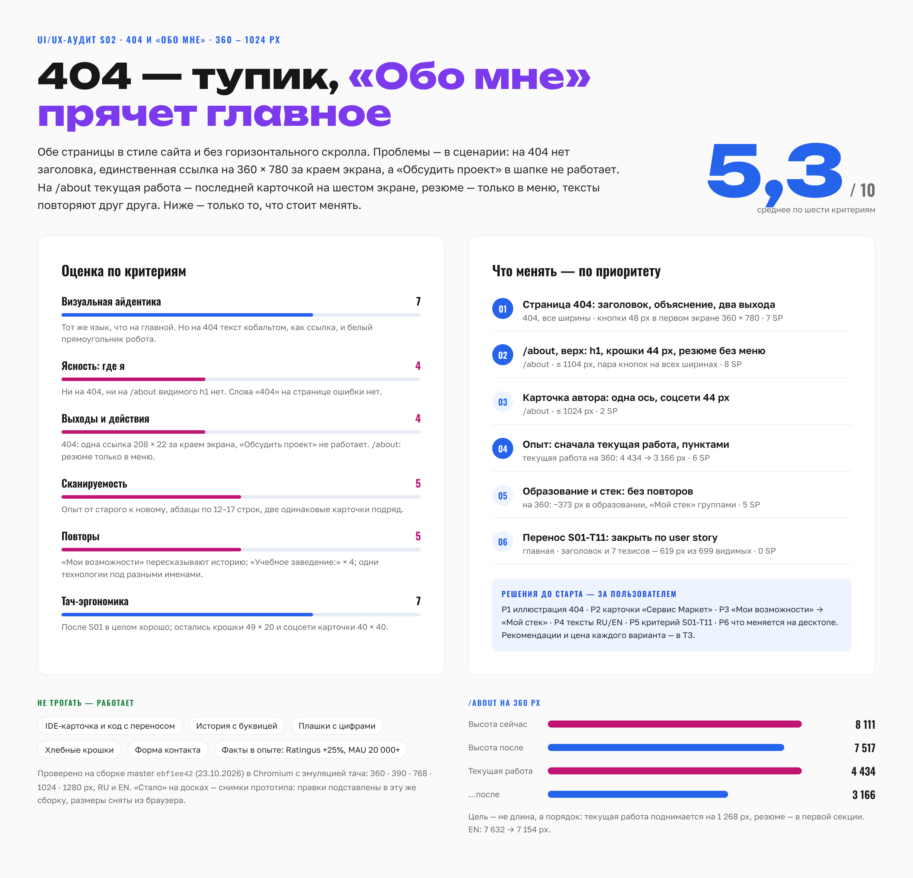
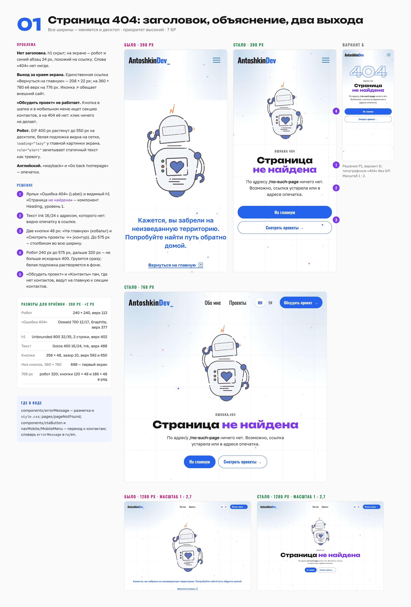
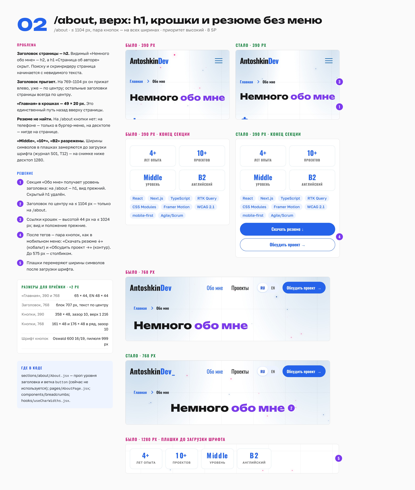
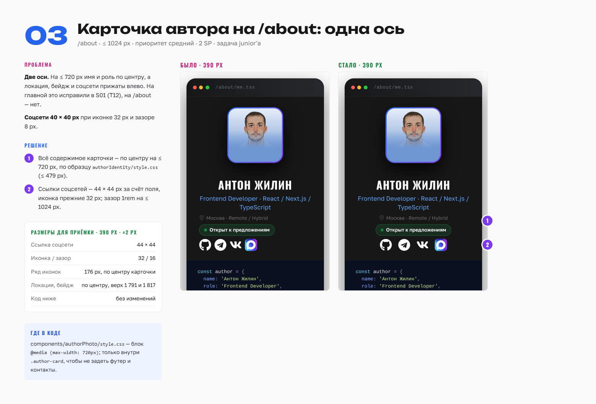
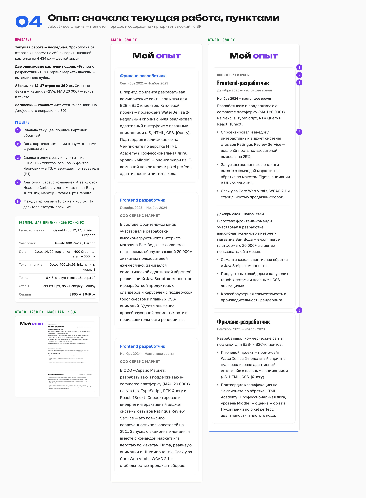
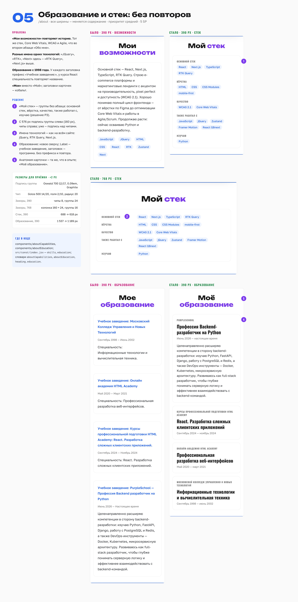

# S02 — 404 и «Обо мне»: UI/UX-улучшения

**Дата:** 23 октября 2026
**Основа:** сборка `master` после S01 (коммит `ebf1ee42`, merge #188). Замеры — в Chromium с эмуляцией тача на 360, 390, 768 и 1024 px, без тача на 1280 px, в RU и EN.
**Папка спринта и ветка:** по скилу `team-lead` — `.claude/sprints/S02-about-404/` и `sprint/S02-about-404` от актуального `master`.
**Референсы:** PNG-доски — в папке `images/` рядом с этим файлом, все шесть с первого дня. Те же доски на холсте аудита, страница «S02 · 404 и «Обо мне»». Слева на доске — проблема, решение, размеры для приёмки и где в коде. Справа — «было» и «стало». Фиолетовые цифры на «стало» — пункты «Решение» на той же доске.

**«Стало» — не рисунок, а снимок прототипа.** Правки из гайдов ниже подставлены в эту же сборку, и браузер их отрисовал. Поэтому размеры в таблицах «Размеры из макета» сняты из браузера, а не на глаз. Как получены цифры — в приложении В.

**Как читать блок.** Каждый блок начинается с «Коротко»: что нужно сделать и как проверить, что готово, — простыми словами. Дальше паспорт, референс, user story, scope, гайд по шагам, размеры из макета, критерии приёмки, проверка, задачи с оценкой и риски.

**Содержание**

1. Цель и сводная оценка
2. Критерии успеха
3. Решения до старта
4. Бэклог спринта
5. Блок 01 · Страница 404
6. Блок 02 · /about, верх страницы
7. Блок 03 · Карточка автора на /about
8. Блок 04 · Опыт
9. Блок 05 · Образование и стек
10. Блок 06 · Перенос S01-T11
11. Кандидаты, не вошедшие в спринт
12. Вне scope
13. Ограничения, Definition of Done и регрессия
14. Что учтено из ретро S01
15. Приложение А · Тексты RU и EN
16. Приложение Б · Черновики карточек junior'а
17. Приложение В · Как получены цифры

---

## Цель и сводная оценка

После S01 главная и /projects на телефоне в порядке, а две страницы остались как были. **404 — тупик:** заголовка нет, единственный выход на 360 × 780 за краем экрана, «Обсудить проект» не работает. **«Обо мне» прячет главное:** текущая работа — последней карточкой на шестом экране, резюме — только в меню, тексты повторяют друг друга.

**Цель S02:** с 404 посетитель за один тап уходит на главную или к проектам, а «Обсудить проект» ведёт к контактам с любой страницы. Рекрутер с телефона на /about сразу видит текущую работу, читает опыт пунктами и скачивает резюме, не открывая меню.



*Доска 00 · Оценка по шести критериям, блоки по приоритету, длина /about и позиция текущей работы до и после.*

---

## Критерии успеха

| Метрика | Сейчас | Цель | Прототип | Как мерить |
| --- | --- | --- | --- | --- |
| 404 на 360 × 780: заголовок, текст и обе кнопки — без прокрутки | h1 нет; ссылка 208 × 22, верх на 776 px | низ второй кнопки ≤ 780 px | 698 px | DevTools → элемент → размеры |
| «Обсудить проект» и «Контакты» на 404 | ничего не происходит | открывается главная, заголовок контактов под шапкой | заголовок на 81 px — сразу под шапкой | клик в шапке и в мобильном меню |
| Видимый h1 на 404 и /about | нет на обеих | ровно один видимый h1 | ✓ | `document.querySelectorAll('h1')` в консоли |
| /about, 360: верх карточки текущей работы | 4 434 px (третья карточка) | первая карточка, ≤ 3 200 px | 3 166 px | DevTools |
| /about, 360: высота страницы | 8 111 px (EN 7 632) | ≤ 7 600 px (EN ≤ 7 200) | 7 517 (EN 7 154) | `document.documentElement.scrollHeight` |
| Резюме на /about без меню | нет | кнопка в первой секции | верх на 1 216 px на 390 | DevTools |
| Цели нажатия на /about, ≤ 1024 px | «Главная» 49 × 20, соцсети карточки 40 × 40 | ≥ 44 px в обе стороны | 65 × 44 (EN 48 × 44); 44 × 44 | DevTools |
| Горизонтальный скролл, 320–1440 px | нет | нет | нет на 360–1280 | ручная проверка |
| Lighthouse mobile /about, Accessibility | замерить в день 1 | не ниже исходного | — | Lighthouse, режим Mobile |

**Цель — не длина, а порядок.** /about станет короче на 7%, но главное — текущая работа поднимается на 1 268 px, а резюме оказывается в первой секции.

---

## Решения до старта

Ретро S01: противоречия и развилки решает пользователь **на планировании, а не на ревью**. Ниже — всё, что влияет на объём или на то, как выглядит результат. По каждому пункту есть рекомендация; без ответа лид берёт рекомендованный вариант.

| № | Вопрос | Варианты | Рекомендация | Влияние на SP |
| --- | --- | --- | --- | --- |
| Р1 | Иллюстрация 404 | **А** — робот остаётся: 240 px на телефоне и 320 px дальше, без растяжения, белая подложка растворяется в фоне. **Б** — GIF убираем, вместо него типографское «404» (Unbounded 800, контур кобальтом); на доске 01 справа | **А**: дешевле, сохраняет характер страницы, файл 26 КБ | одинаково — входит в T02 |
| Р2 | Две карточки «Frontend разработчик · ООО Сервис Маркет» подряд (дек. 2023 — нояб. 2024 и нояб. 2024 — сейчас) | **А** — одна карточка компании с двумя этапами. **Б** — две карточки, но с разными заголовками; заголовки даёт пользователь | **А**: одна компания и один заголовок — один блок, как в резюме и LinkedIn | А — 3 SP в T10; Б — 2 SP |
| Р3 | «Мои возможности» пересказывают второй абзац истории | **А** — раздел «Мой стек»: группы чипов без абзаца. **Б** — абзац остаётся, правим только имена тегов (jQuery, RTK Query, Next.js) | **А**: рекрутер за 5 секунд видит, что основное, а что — «также» | А — 3 SP (T12); Б — 1 SP |
| Р4 | Тексты блоков 01, 04, 05 | Черновик RU и EN — в приложении А. Это нынешние формулировки, разбитые на сводку и пункты, без новых фактов | утвердить до старта T02, T10, T11; правки — итоговым текстом | 0 |
| Р5 | Критерий S01-T11 «высота „Почему именно я“ на 360 ≤ 650 px» | **А** — критерий по user story: «заголовок и все 7 тезисов видны разом под шапкой на 360 × 780», то есть ≤ 699 px. Сейчас 619 / 579 px (RU / EN) — выполнено, задачу закрыть. **Б** — ритм заголовков секций на ≤ 475 px; подробности в блоке 06 | **А** | А — 0 SP; Б — 3 SP и регрессия всех страниц |
| Р6 | Что меняется на десктопе (≥ 1025 px) | Меняется: страница 404 целиком; пара кнопок на /about; порядок, тексты и вид карточек опыта и образования; «Мой стек». Всё остальное — только внутри `max-width` | принять: это содержание страниц, а не адаптив | 0 |

---

## Бэклог спринта

| Блок | Приоритет | SP | Риск | Ширины | Десктоп |
| --- | --- | --- | --- | --- | --- |
| 01 · Страница 404 | P1 | 7 | низкий | все | меняется |
| 02 · /about, верх страницы | P1 | 8 | средний | ≤ 1104 px, пара кнопок — все | пара кнопок |
| 03 · Карточка автора на /about | P2 | 2 | низкий | ≤ 1024 px | нет |
| 04 · Опыт | P1 | 6 | средний | все | меняется |
| 05 · Образование и стек | P2 | 5 | низкий | все | меняется |
| 06 · Перенос S01-T11 | — | 0 | — | — | — |
| **Обязательство** |  | **28** |  |  |  |
| Stretch · T13 · цели нажатия в контактах | P3 | 2 | низкий | ≤ 1024 px | нет |

**Ёмкость.** Шкала SP — командная, 1 / 2 / 3 / 5 / 8 из скила `team-lead`. В S01 команда закрыла 34 SP за 8 календарных дней. В S02 28 SP плюс 2 SP stretch: запас — на новые правила ретро (карточки junior'а простым языком, сверка с макетом) и на ревью.

### Задачи (предложение для `plan.md`)

| ID | Задача | Блок | SP | Исполнитель | Зависит от |
| --- | --- | --- | --- | --- | --- |
| S02-T01 | Статус ответа сервера на 404 и /about | 01 | 1 | Лид | — |
| S02-T02 | Страница 404: разметка, тексты, кнопки, робот | 01 | 3 | Верстальщик | Р1, Р4 |
| S02-T03 | «Обсудить проект» и «Контакты» без секции контактов | 01 | 3 | Лид | — |
| S02-T04 | Видимый h1 на /about | 02 | 1 | Лид | — |
| S02-T05 | Хлебные крошки 44 px и заголовок по центру | 02 | 2 | Junior | — |
| S02-T06 | Пара кнопок «Скачать резюме / Обсудить проект» на /about | 02 | 3 | Верстальщик | T04 |
| S02-T07 | Плашки: ширины символов после загрузки шрифта | 02 | 2 | Лид | — |
| S02-T08 | Карточка автора: одна ось и соцсети 44 px | 03 | 2 | Junior | — |
| S02-T09 | Компонент `ResumeCard` — общая карточка опыта и образования | 04 | 3 | Верстальщик | — |
| S02-T10 | Опыт: данные, порядок, тексты RU/EN | 04 | 3 | Лид | T09, Р2, Р4 |
| S02-T11 | Образование: данные, порядок, тексты RU/EN | 05 | 2 | Верстальщик | T09, Р4 |
| S02-T12 | «Мой стек» вместо «Мои возможности» | 05 | 3 | Верстальщик | Р3 |
| S02-T13 | _Stretch:_ контакты — цели 44 px | — | 2 | Junior или верстальщик | — |

**Итого:** 28 SP + 2 stretch. Лид — 10 (T01, T03, T04, T07, T10), верстальщик — 14 (T02, T06, T09, T11, T12), junior — 4 (T05, T08) + stretch.

**Порядок.** Релиз 1: T01 → T02 → T03, параллельно T04, T05, T08 → PR 1. Релиз 2: T06, T07, T09 → T10 и T11, T12 → T13, если осталось время → PR 2, демо, ретро.

**Junior.** Две CSS-задачи по 2 SP, как решили на ретро: размеры — из макета, в каждой одна новая вещь. Черновики карточек простым языком — в приложении Б. Тесты, JSDoc, `CHANGELOG.md` и коммиты по задачам junior'а — у лида, пока junior не скажет, что готов.

<!-- ═══════════════════════════════════════════════════════════════════ -->

---

## Блок 01 · Страница 404

### Коротко

**Что нужно сделать.** Сейчас на странице ошибки нет заголовка, текст синий, как ссылка, а единственная ссылка «Вернуться на главную» на телефоне уходит за край экрана. Нужно: сверху ярлык «Ошибка 404» и крупный заголовок «Страница не найдена», под ним — тёмный текст с адресом, которого нет, и две большие кнопки «На главную» и «Смотреть проекты». Робот становится меньше и без белого прямоугольника. Кнопка «Обсудить проект» в шапке и в меню должна вести на главную к контактам.

**Как проверить, что готово.** Откройте `/no-such-page` на 360 × 780: заголовок, текст и обе кнопки видны без прокрутки. На 768 и 1280 кнопки стоят в ряд по центру. Нажмите «Обсудить проект» в шапке (1280) и в бургер-меню (390): откроется главная, а заголовок «Свяжитесь со мной» окажется сразу под шапкой.

> **Приоритет:** P1 · **SP:** 7 · **Риск:** низкий · **Ширины:** все · **Десктоп:** меняется (Р6) · **Решения:** Р1, Р4

### Референс



*Доска 01 · Было и стало на 390 px, справа — вариант Б из решения Р1. Ниже — стало на 768 px и обе версии на 1280 px в масштабе 1 : 2,7.*

**User story.** Как посетитель, который попал по старой или опечатанной ссылке, я сразу понимаю, что такой страницы нет и почему, и одним нажатием попадаю на главную или к проектам. А если я хотел обсудить проект, кнопка в шапке приводит меня к контактам.

**Почему.**
- **Нет заголовка.** h1 «Страница не найдена — AntoshkinDev» скрыт классом `visually-hidden`. На экране — GIF и абзац Golos 600 24/32 кобальтом: выглядит как ссылка. Слова «404» на странице нет.
- **Выход за краем экрана.** «Вернуться на главную» — 208 × 22 px; на 360 × 780 её верх на 776 px, низ — на 798, за краем. Иконка `BsBoxArrowInUpRight` (↗) обычно значит «откроется внешний сайт».
- **«Обсудить проект» не работает.** `CtaButton` ищет `.contact`, а «Контакты» в мобильном меню — `#contact-heading`. На 404 их нет: клик ничего не делает — проверено, адрес и прокрутка не меняются.
- **Робот.** GIF 400 × 400 вписан в рамку 850 × 550: на десктопе растянут до 550 px и мылится. Белый фон GIF виден прямоугольником на сетке страницы. `loading="lazy"` у картинки, которая видна сразу, задерживает её отрисовку.
- **Доступность.** `role="alert"` заставляет скринридер зачитать статичный текст как срочное сообщение. Секция `.not-found` вложена в секцию `.page-not-found` без заголовка.
- **Английский.** «Try finding your wayback home» и «Go back homepage» — ошибки.

### Scope

- **Входит:** `components/errorMessage` (JSX и `style.css`), `pages/pageNotFound` (JSX и `style.css`), `components/ctaButton`, `components/navMobile/MobileMenu.jsx`, словарь `errorMessage` в обеих локалях, тесты.
- **Не входит:** настройка хостинга (если T01 найдёт, что сервер отвечает 200), шапка и подвал, мета-теги (`noindex, follow` уже есть).

### Гайд по шагам

**S02-T01 · Статус ответа сервера (лид).**

1. `curl -sI https://antoshkindev.ru/no-such-page | head -1` и то же для `/about`. Из нашей среды сайт недоступен, поэтому статус в этом ТЗ не установлен.
2. Ожидаемо: `/no-such-page` → 404, `/about` → 200. Если неизвестный адрес отвечает 200 («мягкий 404»), запишите это в журнал `plan.md`. Поисковики такую страницу не проиндексируют — `noindex` уже стоит, — но статус 404 честнее. Настройка хостинга вне репозитория, решение — за пользователем.
3. Если `/about` при прямом заходе отвечает 404 — это блокер: прямые ссылки на страницы сломаны. Сразу сообщить пользователю.

**S02-T02 · Страница 404 (верстальщик).**

1. **Разметка `PageNotFound.jsx`.** Остаётся одна секция: `<section className="page-not-found" aria-labelledby="not-found-title">`. Скрытый h1 удалить. Пропсы `textContent` и `btnText` больше не нужны — `ErrorMessage` берёт тексты из словаря сам.
2. **Разметка `ErrorMessage.jsx`.** Корень — `<div className="container not-found">` без `role="alert"`. Порядок:
    - `` — без `loading="lazy"`; атрибуты `width` и `height` резервируют место и убирают сдвиг макета;
    - `<p className="not-found__eyebrow">{t('errorMessage.eyebrow')}</p>`;
    - `<Heading level={1} id="not-found-title" className="not-found__title" title={t('errorMessage.title')} accent={t('errorMessage.accent')} />`;
    - `<p className="not-found__text">` — через `<Trans i18nKey="errorMessage.text" values={{ path }} components={{ path: <span className="not-found__path" /> }} />`. `path` — `useLocation().pathname`, пропущенный через `decodeURIComponent` в `try/catch`: иначе кириллический адрес покажется как `%D1%81…`. React экранирует текст сам, вставка безопасна. Тот же приём с именованными тегами — в `AboutStory`;
    - `<div className="not-found__actions">` с двумя `Link`: `not-found__primary` на `/` и `not-found__secondary` на `/projects` со стрелкой `<span aria-hidden="true">→</span>`.
3. **CSS `errorMessage/style.css`** — заменить целиком (desktop-first):

    ```css
    .not-found { display: flex; flex-direction: column; align-items: center; }
    .not-found__image { display: block; width: 320px; height: 320px; margin-bottom: 1.5rem; mix-blend-mode: multiply; }
    .not-found__eyebrow { margin: 0 0 0.5rem; font-family: var(--font-headings); font-size: 0.75rem; font-weight: 700;
      line-height: 1.4; letter-spacing: 0.09em; text-transform: uppercase; color: var(--color-gray-500); }
    /* 0-2-0 перебивает margin-bottom у .heading-sec--display (3rem, на ≤ 768 — 2rem) */
    .not-found .not-found__title { margin: 0 0 1rem; }
    .not-found__title .heading-sec__accent { white-space: nowrap; }
    .not-found__text { max-width: 32rem; margin: 0 0 2rem; font-size: 1rem; line-height: 1.5;
      color: var(--color-gray-800); text-wrap: pretty; }
    .not-found__path { font-weight: 600; color: var(--color-gray-900); overflow-wrap: anywhere; }
    .not-found__actions { display: flex; flex-wrap: wrap; justify-content: center; gap: 0.625rem; }
    .not-found__primary, .not-found__secondary { display: inline-flex; align-items: center; justify-content: center;
      gap: 0.25rem; box-sizing: border-box; min-height: 48px; padding: 0.5rem 1.25rem; font-family: var(--font-headings);
      font-size: 1rem; font-weight: 600; line-height: 1.2; border: 1.5px solid var(--color-blue-700); border-radius: 999px; }
    .not-found__primary { color: var(--color-white); background-color: var(--color-blue-700); }
    .not-found__secondary { color: var(--color-blue-700); background-color: transparent; }
    @media screen and (max-width: 575px) {
      .not-found__image { width: 240px; height: 240px; }
      .not-found__actions { flex-direction: column; align-self: stretch; }
    }
    ```

    Состояния — как у пары кнопок мобильного меню: у основной при наведении мышью (`@media (hover: hover)`) — `--color-blue-800`, подъём на 1 px и кобальтовая тень, у контурной — фон Frost; `:active` — те же цвета для касания; `:focus-visible` — обводка 2 px кобальтом с отступом 2 px; при `prefers-reduced-motion` — без переходов.
4. **`mix-blend-mode: multiply`** — режим наложения «умножение»: белые пиксели картинки становятся прозрачными на светлом фоне, тёмные линии остаются. Так белый прямоугольник GIF исчезает без нового файла. Внутренняя белая заливка робота тоже станет прозрачной — сквозь неё чуть видна сетка страницы. Это принято на макете.
5. **`pageNotFound/style.css`:** `.page-not-found { padding: calc(var(--header-height) + 2rem) 0 4rem; min-height: 80vh; text-align: center; }`. Отступ сверху — от высоты шапки, как у /about.
6. **Словари.** Ключи `errorMessage.eyebrow`, `title`, `accent`, `text`, `home`, `projects` — тексты в приложении А. Старые `errorMessage.message` и `errorMessage.back` удалить из обеих локалей.
7. **`DESIGN.md`:** абзац «404 page» в Components; в «Buttons» у Primary (pill) и Outline добавить новые места.

**S02-T03 · «Обсудить проект» и «Контакты» без секции контактов (лид).**

1. **Цель прокрутки — одна:** `#contact-heading`. У этого id уже есть `scroll-margin-top: var(--header-height)` (правило `[id$='-heading']` в `main.css`), поэтому заголовок встаёт сразу под шапкой.
2. **`CtaButton`:** в `handleClick` после `onClick?.()` и кадра — `document.getElementById('contact-heading')`. Нашёлся — `scrollIntoView({ behavior })`, нет — `navigate('/#contact-heading')` из `useNavigate`. `behavior` — `'auto'` при `prefers-reduced-motion` (`useReducedMotion` из `motion/react`, как в `MobileMenu`), иначе `'smooth'`. Это заодно закрывает пункт журнала S01 «reduced motion в `CtaButton`».
3. **`MobileMenu`:** в `handleContactsClick` — та же развилка: цели нет → `onClose()` и `navigate('/#contact-heading')`.
4. **Почему этого достаточно.** `ScrollToTop` уже умеет переход с хешем: после смены адреса он ~1,5 с ищет цель и докручивает к ней, даже если секция грузится лениво. Проверено на сборке: с 404 переход на `/#contact-heading` ставит заголовок контактов на 81 px — сразу под шапкой — меньше чем за 0,5 с.
5. **Тесты.** `CtaButton.test.jsx`: в `MemoryRouter` без `#contact-heading` клик меняет адрес на `/#contact-heading`; с целью — вызывает `scrollIntoView`, адрес прежний. `MobileMenu.test.jsx`: то же для «Контактов» и «Обсудить проект» в меню, меню закрывается.

### Размеры из макета (±2 px)

| Элемент | 390 px | 768 px | 1280 px |
| --- | --- | --- | --- |
| Робот | 240 × 240, верх 113 | 320 × 320, верх 113 | 320 × 320, верх 141 |
| «Ошибка 404» | Oswald 700 12/17, трекинг 0.09em, Graphite; верх 377 | верх 457 | верх 485 |
| h1 | Unbounded 800 32/35, Carbon + Violet, 2 строки (358 × 70); верх 402 | 38,4/42, 1 строка; верх 482 | 56/62, 1 строка; верх 510 |
| Текст | Golos 400 16/24, Ink, 3 строки; верх 488 | ширина 512, 2 строки; верх 540 | ширина 512, 2 строки |
| Кнопки | 358 × 48 столбиком, зазор 10; верх 592 и 650 | 120 × 48 и 186 × 48 в ряд, зазор 10; верх 620 | то же; верх 667 |
| Шрифт кнопок | Oswald 600 16/19, радиус 999 | | |
| Низ второй кнопки на 360 × 780 | 698 — без прокрутки | | |
| Высота страницы | 1 193 → 986 (на 360) | 1 519 → 1 181 | 1 201 → 1 022 |

### Критерии приёмки

**Из user story**

- [ ] На 360 × 780 без прокрутки видны «Ошибка 404», заголовок «Страница не найдена», текст с адресом и обе кнопки; низ второй кнопки ≤ 780 px.
- [ ] «На главную» ведёт на `/`, «Смотреть проекты» — на `/projects`. Обе кнопки — 48 px в высоту; до 575 px — во всю ширину столбиком, шире — в ряд по центру.
- [ ] В тексте показан адрес, которого нет, в читаемом виде: `/страница`, а не `%D1%81…`.
- [ ] «Обсудить проект» в шапке (1280) и в мобильном меню (390), а также «Контакты» в меню открывают главную; заголовок «Свяжитесь со мной» — сразу под шапкой.
- [ ] На главной и /about эти кнопки по-прежнему прокручивают к контактам без перехода.

**Технические**

- [ ] На странице ровно один h1, он видимый; `role="alert"` нет; вложенной секции нет.
- [ ] Робот не шире 400 px ни на одной ширине; у `img` нет `loading="lazy"`, есть `width` и `height`; белого прямоугольника на сетке нет.
- [ ] Текст — Ink, не кобальт; размеры — по таблице выше, ±2 px.
- [ ] `ru.json` и `en.json` синхронны, `errorMessage.message` и `errorMessage.back` удалены.
- [ ] При `prefers-reduced-motion` переход к контактам без плавной прокрутки.
- [ ] Записан статус ответа сервера для `/no-such-page` и `/about` (T01).

### Проверка

- Ширины: 320, 360, 390, 575 / 576, 768, 1024, 1280, 1440; RU и EN.
- Клавиатура: Tab идёт «На главную» → «Смотреть проекты», фокус-кольцо видно.
- Длинный адрес (`/a/очень-длинный-адрес-без-пробелов-…`) переносится и не даёт горизонтального скролла.
- Медленная сеть (DevTools → Slow 4G): робот появляется сразу, вёрстка не прыгает.

### Задачи и оценка

| ID | Задача | SP | Исполнитель |
| --- | --- | --- | --- |
| S02-T01 | Статус ответа сервера | 1 | Лид |
| S02-T02 | Страница 404 | 3 | Верстальщик |
| S02-T03 | Переход к контактам с любой страницы | 3 | Лид |

### Риски

- `mix-blend-mode` не работает в очень старых браузерах — там останется нынешний белый прямоугольник, страница не ломается.
- Если по Р1 выбран вариант Б, шаг 3 меняется: вместо `img` — `<span class="not-found__code" aria-hidden="true">404</span>` (Unbounded 800, `clamp(6rem, 28vw, 10rem)`, заливка Frost, контур 2 px кобальтом); GIF удаляется из `assets`. SP те же.
- Стили пилюли теперь в трёх местах: мобильное меню, 404 и /about (блок 02). Вынести в общий класс — кандидат в S03, не в этом спринте.

<!-- ═══════════════════════════════════════════════════════════════════ -->

---

## Блок 02 · /about, верх страницы

### Коротко

**Что нужно сделать.** На странице «Обо мне» сделать видимый заголовок главным (h1), увеличить зону нажатия у «Главная» в хлебных крошках, выровнять заголовок по центру на планшете и добавить под тегами две кнопки: «Скачать резюме» и «Обсудить проект». Ещё — починить разрежённые «Middle», «10+» и «B2» в плашках.

**Как проверить, что готово.** На 390: «Главная» в крошках — 65 × 44 px, текст на месте; под тегами — две кнопки во всю ширину. На 768: заголовок «Немного обо мне» по центру, кнопки в ряд. На 1280 после жёсткой перезагрузки на медленной сети «Middle» в плашке не разрежён.

> **Приоритет:** P1 · **SP:** 8 · **Риск:** средний · **Ширины:** крошки ≤ 1024 px, заголовок ≤ 1104 px, кнопки — все · **Десктоп:** только пара кнопок (Р6)

### Референс



*Доска 02 · Верх страницы и конец первой секции на 390 px, заголовок на 768 px, внизу — плашки на 1280 px до загрузки шрифта.*

**User story.** Как рекрутер с телефона, я открываю «Обо мне» и, дочитав первую секцию, сразу скачиваю резюме или пишу автору — без поиска по меню. Если захочу назад, легко попадаю пальцем в «Главная».

**Почему.**
- **h1 скрыт.** Видимый «Немного обо мне» — h2 (`Heading` по умолчанию `level = 2`), а h1 «Страница об авторе» скрыт. h1 — главный заголовок страницы, по нему поиск и скринридер понимают, о чём она; он должен быть один и видимый.
- **Заголовок прыгает.** На ≤ 1104 px `.about__left` — flex-строка с `align-items: flex-start`, и заголовок сжимается по тексту. Пока он в одну строку — стоит слева (768 px), когда переносится — по центру (360 px). Остальные заголовки /about всегда по центру — правило `DESIGN.md` «always centered on section headings».
- **«Главная» — 49 × 20 px** (EN «Home» — 32 × 20). Цель нажатия — область, в которую попадает палец; в S01 договорились о 44 px.
- **Резюме не найти.** На /about кнопки нет: на телефоне — только в бургер-меню, на десктопе — нигде. Ветка `button` в `About.jsx` (CV и соцсети) есть, но нигде не используется; её файл называется `my-cv.pdf`, а в меню и на главной — `Anton_Zhilin_CV.pdf`.
- **«Middle», «10+», «B2» разрежены.** `useCharWidths` меряет ширины символов шрифтом-заменой, если веб-шрифт ещё не загрузился. После `document.fonts.ready` строка `font` та же, и перемер выходит сразу (`if (font === lastFont) return`). Найдено в S01 (T12), на доске — снимок 1280 px.

### Scope

- **Входит:** `sections/about/About.jsx` и `style.css`, `pages/AboutPage.jsx`, `components/breadcrumbs/style.css`, `hooks/useCharWidths.jsx`, словари, тесты.
- **Не входит:** тексты истории (`AboutStory`), плашки и теги — кроме перемера ширин, главная — кроме побочных эффектов (ниже).
- **Побочные эффекты:** крошки есть и на /projects (`ProjectsHeader`), `useCharWidths` — и в подзаголовке героя на главной. Проверить обе страницы.

### Гайд по шагам

**S02-T04 · Видимый h1 (лид).**

1. `About` получает проп `headingLevel` (по умолчанию 2) и передаёт его в `Heading` как `level`.
2. `AboutPage`: `<About border headingLevel={1} />`; скрытый `<h1 className="visually-hidden">` удалить. Ключ `pages.about.title` больше нигде не используется — удалить из обеих локалей.
3. Тест: на `/about` ровно один `h1`, его текст — «Немного обо мне»; на главной у секции по-прежнему h2.

**S02-T05 · Крошки 44 px и заголовок по центру (junior).** Карточка простым языком — в приложении Б.

1. `components/breadcrumbs/style.css`, в конец файла:

    ```css
    @media screen and (max-width: 1024px) {
      .breadcrumbs { padding-block: 0; }
      .breadcrumbs__link { display: inline-flex; align-items: center; min-height: 44px;
        padding-inline: 0.5rem; margin-inline: -0.5rem; }
    }

    @media screen and (max-width: 1023px) {
      .breadcrumbs { margin-bottom: 1rem; }
    }
    ```

    Отрицательные поля по бокам равны внутренним: зона нажатия шире на 8 px с каждой стороны, а текст и стрелка не сдвигаются. `margin-bottom: 1rem` вместо 1.5rem компенсирует выросшую высоту ссылки.
2. `sections/about/style.css`, внутри существующего `@media screen and (max-width: 1104px)`:

    ```css
    .about__without .about__left .heading-sec--display { width: 100%; }
    ```

    Заголовок растягивается на всю строку, и его `text-align: center` начинает работать. `.about__without` есть только на /about, главная не меняется.

**S02-T06 · Пара кнопок (верстальщик).** После T04 — оба меняют `About.jsx`.

1. Ветку `button` в `About.jsx` заменить:

    ```jsx
    {button && (
      <div className="about__actions">
        <a className="about__cv" href={cvPdf} download="Anton_Zhilin_CV.pdf">
          {t('hero.btn')}
          <span aria-hidden="true">↓</span>
        </a>
        <CtaButton variant="outline" />
      </div>
    )}
    ```

    Имя файла — как в меню и на главной. `promo__btn`, `BsBoxArrowInUpRight` и `SocialList` из этой ветки уходят; ключи `promo.promoBtn` и `about.cvAriaLabel` использовались только здесь — удалить из обеих локалей. Подписи — существующие `hero.btn` и `modal.cta`.
2. `AboutPage`: `<About border button headingLevel={1} />`.
3. CSS в `sections/about/style.css`: `.about__actions { display: flex; flex-wrap: wrap; gap: 0.625rem; }`; `.about__cv` — те же значения, что у `.nav-mobile__cv` (min-height 48, поля 0.5rem 1.25rem, Oswald 600 1rem/1.2, кобальт, радиус 999), с состояниями hover только для мыши, `:active`, `:focus-visible` и без переходов при reduced motion; `.about__actions .cta-button--outline { gap: 0.25rem; }`; в `@media (max-width: 575px)` — `.about__actions { flex-direction: column; }`. Мёртвые правила `.about__btns` удалить.
4. `DESIGN.md`, «Buttons»: у Primary (pill) и Outline добавить пару на /about.

**S02-T07 · Перемер ширин символов (лид).**

1. В `useCharWidths`: перед перемером по `document.fonts.ready` сбрасывать `lastFont = ''` — тогда тот же `font` перемеряется уже загруженным шрифтом. Плюс подписка на `document.fonts` `loadingdone` (с отпиской в cleanup) — на случай, если шрифт начал грузиться позже `ready`.
2. Тест: мок `document.fonts` с управляемым `ready` и `measureText`, который возвращает разные ширины до и после загрузки; после `ready` хук отдаёт новые ширины.
3. Проверка: главная (подзаголовок героя) и /about (плашки) на Slow 4G с очисткой кеша.

### Размеры из макета (±2 px)

| Элемент | 390 px | 768 px | 1024 px |
| --- | --- | --- | --- |
| «Главная» в крошках | 65 × 44 (EN «Home» 48 × 44); текст ниже на 2 px | то же | 79 × 44 |
| Заголовок «Немного обо мне» | верх 157 (было 161) | блок 707 px, текст по центру; верх 157 | верх 201 (было 205) |
| Кнопки | 358 × 48 столбиком, зазор 10; верх 1 216 | 161 × 48 и 176 × 48 в ряд, зазор 10; верх 870 | в ряд |
| Шрифт кнопок | Oswald 600 16/19, радиус 999; основная — кобальт, вторая — контур 1.5 px | | |

### Критерии приёмки

**Из user story**

- [ ] На /about под тегами — «Скачать резюме ↓» и «Обсудить проект →»; до 575 px — столбиком во всю ширину, шире — в ряд.
- [ ] «Скачать резюме» скачивает `Anton_Zhilin_CV.pdf`; «Обсудить проект» прокручивает к контактам этой же страницы.
- [ ] «Главная» в крошках на ≤ 1024 px — не меньше 44 px в высоту и ширину (RU и EN); текст и стрелка на месте (±2 px).
- [ ] На 769–1104 px заголовок «Немного обо мне» по центру, как на телефоне.

**Технические**

- [ ] На /about ровно один h1, и он видимый; на главной у «Немного обо мне» — h2.
- [ ] Ключи `pages.about.title`, `promo.promoBtn`, `about.cvAriaLabel` удалены из обеих локалей, если нигде больше не используются.
- [ ] После загрузки шрифта «Middle», «10+», «B2» в плашках не разрежены (Slow 4G, без кеша), подзаголовок героя на главной — тоже.
- [ ] Главная: секция «Обо мне» не изменилась (ширины 360, 768, 1280).
- [ ] /projects: крошки 44 px, заголовок сдвинулся не больше чем на 4 px.

### Проверка

- Ширины: 360, 390, 575 / 576, 768, 1024, 1104 / 1105, 1280; RU и EN.
- Главная и /projects — из-за общих компонентов.
- Клавиатура: Tab по крошкам и паре кнопок, фокус-кольцо видно.

### Задачи и оценка

| ID | Задача | SP | Исполнитель |
| --- | --- | --- | --- |
| S02-T04 | Видимый h1 | 1 | Лид |
| S02-T05 | Крошки 44 px и заголовок по центру | 2 | Junior |
| S02-T06 | Пара кнопок | 3 | Верстальщик |
| S02-T07 | Перемер ширин символов | 2 | Лид |

### Риски

- T04 и T06 меняют один файл — строго по порядку.
- Баг `useCharWidths` воспроизводится не всегда: зависит от того, успел ли шрифт загрузиться. Тест с моком важнее ручной проверки.

<!-- ═══════════════════════════════════════════════════════════════════ -->

---

## Блок 03 · Карточка автора на /about

### Коротко

**Что нужно сделать.** В тёмной карточке автора на телефоне имя и роль стоят по центру, а город, бейдж «Открыт к предложениям» и иконки соцсетей прижаты влево. Нужно поставить всё по центру и увеличить зону нажатия у иконок до 44 px, не меняя их размер.

**Как проверить, что готово.** На 390 и 720 всё содержимое карточки над кодом — по одной центральной линии. Иконки соцсетей — 32 px, но зона нажатия у каждой 44 × 44 (DevTools), между иконками 16 px. На 721 и шире карточка выглядит как раньше.

> **Приоритет:** P2 · **SP:** 2 · **Риск:** низкий · **Ширины:** центровка ≤ 720 px, соцсети ≤ 1024 px · **Десктоп:** не меняется

### Референс



*Доска 03 · Карточка автора на 390 px до и после.*

**User story.** Как посетитель с телефона, я вижу карточку автора собранной и аккуратной и без промахов открываю его GitHub или Telegram.

**Почему.** На ≤ 720 px `.author-content` переходит в колонку с `text-align: center`, но город, бейдж и соцсети — flex-элементы, `text-align` их не центрирует: две оси в одной карточке. На главной то же самое исправили в S01 (T12) — в `authorIdentity/style.css` на ≤ 479 px; на /about карточка другая (`AuthorPhoto`), там осталось. Ссылки соцсетей — 40 × 40 (иконка 32 + поле 4 px).

### Scope

- **Входит:** `components/authorPhoto/style.css`.
- **Не входит:** код в карточке, `AuthorMeta` и `SocialList` (стили только внутри `.author-card`, чтобы не задеть футер и контакты), карточка на главной.

### Гайд по шагам

**S02-T08 · Одна ось и соцсети 44 px (junior).** Карточка простым языком — в приложении Б.

1. В существующий `@media (max-width: 720px)` в `authorPhoto/style.css`:

    ```css
    .author-card .author-meta { align-items: center; }
    .author-card .author-meta__location { justify-content: center; }
    .author-card .author-meta__badge { align-self: center; }
    .author-card .socials { justify-content: center; }
    ```

    Образец — блок `@media (max-width: 479px)` в `authorIdentity/style.css`: там то же решение для карточки на главной.
2. Новый блок ниже по файлу:

    ```css
    @media (max-width: 1024px) {
      .author-card .socials { gap: 1rem; }
      .author-card .socials__link { padding: 6px; margin: -6px; }
    }
    ```

    6 px — не «на глаз»: (44 − 32) / 2. Иконка остаётся 32 px, зона нажатия становится 44, а отрицательные поля не дают иконкам сдвинуться. Зазор 1rem: иначе зоны соседних иконок накладывались бы.
3. Специфичность: `.author-card .author-meta` (0-2-0) сильнее `.author-meta` (0-1-0) из другого CSS-файла, поэтому порядок подключения файлов не важен.

### Размеры из макета (±2 px)

| Элемент | 390 px | 768 px |
| --- | --- | --- |
| Ссылка соцсети | 44 × 44 | 44 × 44 |
| Иконка / зазор | 32 / 16 | 32 / 16 |
| Ряд иконок | 176 px, по центру карточки (x 108–284) | слева, как сейчас |
| Город, бейдж | по центру; верх 1 791 и 1 817 | как сейчас |
| Высота карточки | 832 → 832 | 585 → 585 |

### Критерии приёмки

**Из user story**

- [ ] На ≤ 720 px имя, роль, город, бейдж и соцсети — по одной центральной оси.
- [ ] Каждая ссылка соцсети на ≤ 1024 px — 44 × 44, иконка — 32 px.

**Технические**

- [ ] На ≥ 721 px карточка не изменилась, кроме зазора между иконками на ≤ 1024 px.
- [ ] Футер и контакты (там тоже `SocialList`) не изменились.
- [ ] Высота карточки на 390 и 768 — прежняя (±2 px).

### Проверка

- Ширины: 360, 390, 480, 720 / 721, 768, 1024 / 1025.
- Главная: карточка в секции «Обо мне» не изменилась.

### Задачи и оценка

| ID | Задача | SP | Исполнитель |
| --- | --- | --- | --- |
| S02-T08 | Одна ось и соцсети 44 px | 2 | Junior |

### Риски

- Низкий: только CSS внутри одной карточки. Между зонами нажатия соседних иконок остаётся 4 px — они не накладываются, для этого и нужен зазор 1rem.

<!-- ═══════════════════════════════════════════════════════════════════ -->

---

## Блок 04 · Опыт

### Коротко

**Что нужно сделать.** Сейчас опыт идёт от старого к новому, и текущая работа — последняя карточка. Две карточки «Frontend разработчик · ООО Сервис Маркет» подряд выглядят как дубль, а текст — сплошные абзацы. Нужно: сначала текущая работа; одна карточка «Сервис Маркет» с двумя этапами; в каждом этапе — одна фраза-сводка и пункты. Заголовки карточек — тёмные, а не синие, как ссылки. Для этого делаем общую карточку `ResumeCard` — её же возьмёт образование в блоке 05.

**Как проверить, что готово.** На 360 первая карточка опыта — «ООО «Сервис Маркет» · Frontend-разработчик · Декабрь 2023 — настоящее время», её верх около 3 166 px (было 4 434). Внутри два этапа с датами, разделённые тонкой линией, у каждого — сводка и пункты с серой точкой. Вторая карточка — «Фриланс-разработчик».

> **Приоритет:** P1 · **SP:** 6 · **Риск:** средний · **Ширины:** все · **Десктоп:** меняется (Р6) · **Решения:** Р2, Р4

### Референс



*Доска 04 · Раздел «Мой опыт» целиком на 390 px до и после; слева внизу — стало на 1280 px в масштабе 1 : 3,6.*

**User story.** Как рекрутер с телефона, я открываю раздел опыта и первой вижу текущую работу. За несколько секунд понимаю роль, компанию, срок и главные результаты — Ratingus +25%, MAU 20 000+, — не вчитываясь в абзацы.

**Почему.**
- **Хронология от старого к новому.** На 360 px верх текущей карточки — 4 434 px, шестой экран.
- **Две одинаковые карточки подряд.** Компания и заголовок совпадают, отличаются только даты — выглядит как ошибка копирования.
- **Сплошной текст.** Абзацы — 12–17 строк на 360 px. Сильные факты тонут.
- **Заголовки кобальтом** (Golos 600, `--color-blue-700`) читаются как ссылки. На /projects в S01 это уже исправили: «текст карточки — текст, а не ссылки» (`DESIGN.md`, Project card).
- **Между карточками 40 px** на ≤ 768 px — значения нет в шкале `DESIGN.md`.

### Scope

- **Входит:** новый компонент `components/resumeCard/` (JSX и `style.css`), `components/aboutExperience/` (JSX и `style.css`), `src/const/index.jsx` (`experienceItems`), словарь `aboutExperience` в обеих локалях, тесты, `DESIGN.md`.
- **Не входит:** заголовок раздела, раскладка «заголовок слева, карточки справа» на десктопе, отступы между карточками на ≥ 769 px.

### Гайд по шагам

**Анатомия карточки** — термины из `DESIGN.md`:
- **Label** — подпись над заголовком: Oswald 700, 0.75rem, трекинг 0.09em, прописные, Graphite. Здесь — компания или учебное заведение.
- **Headline** — заголовок карточки: Oswald 600, `clamp(1.5rem, 2.5vw, 1.625rem)`, межстрочный 1.25, Carbon.
- **Meta** — даты: Golos 400, 0.875rem, межстрочный 1.4, Graphite.
- **Body** — текст: Golos 400, 1rem, межстрочный 1.625 (как описание карточки проекта после S01), Ink.

**S02-T09 · Компонент `ResumeCard` (верстальщик).**

1. `src/components/resumeCard/ResumeCard.jsx` — пропсы `label`, `title`, `date`, `stages` (массив `{ date, summary, points }`), `text`, `className`; всё, кроме `title` и `date`, необязательно. Разметка:

    ```jsx
    <article className={`resume-card ${className}`}>
      {label && <p className="resume-card__label">{label}</p>}
      <header className="resume-card__head">
        <h3 className="resume-card__title">{title}</h3>
        <span className="resume-card__date">{date}</span>
      </header>
      {stages?.map((stage) => (
        <div className="resume-card__stage" key={stage.summary}>
          {stage.date && <p className="resume-card__stage-date">{stage.date}</p>}
          <p className="resume-card__summary">{stage.summary}</p>
          {stage.points?.length > 0 && (
            <ul className="resume-card__points">
              {stage.points.map((point) => <li key={point}>{point}</li>)}
            </ul>
          )}
        </div>
      ))}
      {text && <p className="resume-card__text">{text}</p>}
    </article>
    ```

2. `style.css` — значения прототипа:

    ```css
    .resume-card { background: var(--color-white); border: 1px solid rgba(0, 0, 0, 0.06); border-radius: 16px;
      padding: clamp(1.4rem, 1rem + 1.6vw, 2.25rem); }
    .resume-card__label { margin: 0 0 0.5rem; font-family: var(--font-headings); font-size: 0.75rem; font-weight: 700;
      line-height: 1.4; letter-spacing: 0.09em; text-transform: uppercase; color: var(--color-gray-500); }
    .resume-card__head { display: flex; align-items: baseline; justify-content: space-between; gap: 1rem; }
    .resume-card__title { margin: 0; font-family: var(--font-headings); font-size: clamp(1.5rem, 2.5vw, 1.625rem);
      font-weight: 600; line-height: 1.25; color: var(--color-gray-900); }
    .resume-card__date { flex-shrink: 0; font-size: 0.875rem; line-height: 1.4; color: var(--color-gray-500); white-space: nowrap; }
    .resume-card__stage { margin-top: 1rem; }
    .resume-card__stage + .resume-card__stage { margin-top: 1.5rem; padding-top: 1.5rem; border-top: 1px solid rgba(0, 0, 0, 0.08); }
    .resume-card__stage-date { margin: 0 0 0.5rem; font-size: 0.875rem; font-weight: 600; line-height: 1.4; color: var(--color-gray-800); }
    .resume-card__summary, .resume-card__text { margin: 0; font-size: 1rem; line-height: 1.625; color: var(--color-gray-800); text-wrap: pretty; }
    .resume-card__text { margin-top: 1rem; }
    .resume-card__points { display: flex; flex-direction: column; gap: 0.5rem; margin: 0.5rem 0 0; padding: 0; list-style: none; }
    .resume-card__points li { position: relative; padding-left: 1rem; font-size: 1rem; line-height: 1.625;
      color: var(--color-gray-800); text-wrap: pretty; }
    .resume-card__points li::before { content: ''; position: absolute; left: 0; top: 10px; width: 6px; height: 6px;
      border-radius: 50%; background: var(--color-gray-500); }
    @media screen and (max-width: 768px) {
      .resume-card__head { flex-direction: column; align-items: flex-start; gap: 0.5rem; }
    }
    ```

    Точка — `top: 10px`: строка 26 px, центр точки 6 px — на высоте строчных букв. Линия между этапами — тот же нейтральный `rgba(0, 0, 0, 0.08)`, что у таблицы карточки проекта.
3. JSDoc на русском; `DESIGN.md` — абзац «Resume card (experience, education)» в Components.

**S02-T10 · Опыт: данные, порядок, тексты (лид).**

1. Тексты — в словаре массивом, порядок задаёт сам массив: `aboutExperience.items` — сначала текущая работа. Структура и тексты RU/EN — в приложении А. Читать через `t('aboutExperience.items', { returnObjects: true })`.
2. `experienceItems` в `src/const/index.jsx` больше не нужен — удалить. Старые ключи `aboutExperience.name`, `titleOne…`, `textOne…`, `dateOne…` — удалить из обеих локалей.
3. `AboutExperience.jsx`: `items.map((item, index) => <li key={index}><ResumeCard {...item} className="about-experience__item" /></li>)`. Класс `about-experience__item` остаётся для отступов списка; старые правила `__head`, `__title`, `__date`, `__name`, `__item-text` в `aboutExperience/style.css` удалить.
4. В `@media (max-width: 768px)` у `.about-experience__experience-list` — `gap: 1rem` вместо 40px.
5. Тесты: первая карточка — текущая работа; у карточки «Сервис Маркет» два этапа; пункты — элементы списка; при `returnObjects` не массивом (ключ потерян) компонент не падает.

### Размеры из макета (±2 px)

| Элемент | 390 px | 768 px |
| --- | --- | --- |
| Поля карточки | 22,4 | 28,3 |
| Label «ООО «Сервис Маркет»» | Oswald 700 12/17, Graphite; верх через 23 от края карточки (поле 22,4 + рамка 1) | через 29 |
| Заголовок | Oswald 600 24/30, Carbon; ниже Label на 8 | то же |
| Даты карточки | Golos 400 14/20, Graphite; под заголовком через 8 | под заголовком через 8 |
| Дата этапа | Golos 600 14/20, Ink; через 16 после даты карточки | то же |
| Сводка и пункты | Golos 400 16/26, Ink; пункты через 8, отступ текста 16, точка 6 × 6 | то же |
| Между этапами | линия 1 px, по 24 сверху и снизу | то же |
| Между карточками | 16 (было 40) | 16 (было 40) |
| Карточка «Сервис Маркет» | 358 × 1 025 | 707 × 673 |
| Раздел «Мой опыт» | 1 865 → 1 649 | 1 359 → 1 224 |
| Верх текущей работы | 4 145 → 3 043 (на 360: 4 434 → 3 166) | — |

С 769 px дата — справа от заголовка в той же строке, как сейчас.

### Критерии приёмки

**Из user story**

- [ ] Первая карточка — текущая работа «ООО «Сервис Маркет»»; на 360 её верх ≤ 3 200 px.
- [ ] Одна карточка «Сервис Маркет» с двумя этапами (по Р2); у каждого этапа — дата, сводка и пункты.
- [ ] Тексты совпадают с утверждёнными в Р4, в RU и EN; новых фактов нет.
- [ ] Заголовки карточек — Carbon, не кобальт; размеры — по таблице, ±2 px.

**Технические**

- [ ] `ResumeCard` — отдельный компонент с JSDoc; опыт рендерит его, разметка — `ul > li > article`, пункты — `ul > li`.
- [ ] `experienceItems` и старые ключи удалены; `ru.json` и `en.json` синхронны.
- [ ] Между карточками 16 px на ≤ 768 px; на ≥ 769 px отступы прежние.
- [ ] Абзац «Resume card» в `DESIGN.md`.

### Проверка

- Ширины: 360, 390, 768 / 769, 1024, 1280; RU и EN.
- Скринридер: VoiceOver или NVDA объявляет «список, 3 пункта» у пунктов.

### Задачи и оценка

| ID | Задача | SP | Исполнитель |
| --- | --- | --- | --- |
| S02-T09 | Компонент `ResumeCard` | 3 | Верстальщик |
| S02-T10 | Опыт: данные, порядок, тексты | 3 | Лид |

### Риски

- Тексты — главный риск: без утверждения Р4 T10 не начинать.
- Если по Р2 выбран вариант Б, этапов нет: две карточки по одному этапу, заголовки — от пользователя; T10 — 2 SP.

<!-- ═══════════════════════════════════════════════════════════════════ -->

---

## Блок 05 · Образование и стек

### Коротко

**Что нужно сделать.** «Мои возможности» почти слово в слово повторяют второй абзац «Обо мне», а теги там называют те же технологии по-другому («JQuery», «RTK», «Next»). Нужно: заменить раздел на «Мой стек» — группы чипов без абзаца. В образовании — новое сверху; убрать префикс «Учебное заведение:» и повтор специальности; карточки — та же `ResumeCard`, что в опыте. И «Моё» с буквой «ё».

**Как проверить, что готово.** На 390 раздел «Мой стек» — пять групп с серыми подписями и чипами; на 768 подписи слева в колонке 160 px, чипы справа. В образовании первая карточка — PurpleSchool, последняя — колледж 1998–2002; ни одного «Учебное заведение:».

> **Приоритет:** P2 · **SP:** 5 · **Риск:** низкий · **Ширины:** все · **Десктоп:** меняется (Р6) · **Решения:** Р3, Р4

### Референс



*Доска 05 · Сверху — «Мои возможности» и «Мой стек» на 390 px, ниже — стек на 768 px, внизу — образование на 390 px до и после.*

**User story.** Как рекрутер, я за 5 секунд вижу основной стек кандидата и чем он владеет дополнительно, а в образовании первым — то, чему он учится сейчас.

**Почему.**
- **Повтор.** Абзац «Мои возможности» пересказывает второй абзац истории: тот же стек, Core Web Vitals, WCAG 2.1 и Agile/Scrum.
- **Разные имена одних технологий.** В разделе — `JQuery`, `RTK`, `Next` (константа `skills`), выше — `RTK Query`, `Next.js`. Правильное написание — jQuery.
- **Образование с 1998 года.** Текущая учёба — последней карточкой.
- **Шум.** Все четыре заголовка начинаются с «Учебное заведение:»; у курса React специальность повторяет название.
- **Опечатка:** «Мое образование».

### Scope

- **Входит:** `components/aboutCapabilities/` (JSX и `style.css`), `components/aboutEducation/` (JSX и `style.css`), `src/const/index.jsx` (`skills`, `education`), словари `heading.capabilities`, `heading.education`, `aboutCapabilities`, `aboutEducation`.
- **Не входит:** теги под историей (`ABOUT_TECH_TAGS`), анимация появления чипов.

### Гайд по шагам

**S02-T11 · Образование (верстальщик).** После T09.

1. `aboutEducation.items` — массив в словаре, новое сверху; тексты RU/EN — в приложении А. Label — учебное заведение, заголовок — программа. `text` — только у PurpleSchool.
2. `education` в `src/const/index.jsx` и старые ключи `title1…`, `textOne…`, `dateOne…` удалить.
3. `AboutEducation.jsx` рендерит `ResumeCard`; старые правила `__head`, `__title`, `__date`, `__item-text` удалить; в `@media (max-width: 768px)` — `gap: 1rem` у списка вместо 40px.
4. `heading.education.name`: «Моё» (RU); EN без изменений.

**S02-T12 · «Мой стек» (верстальщик).** По Р3, вариант А.

1. Константа вместо `skills`:

    ```js
    export const STACK_GROUPS = [
      { key: 'core', items: ['React', 'Next.js', 'TypeScript', 'RTK Query'] },
      { key: 'layout', items: ['HTML', 'CSS', 'CSS Modules', 'mobile-first'] },
      { key: 'quality', items: ['WCAG 2.1', 'Core Web Vitals'] },
      { key: 'also', items: ['JavaScript', 'jQuery', 'Zustand', 'Framer Motion', 'React i18next'] },
      { key: 'learning', items: ['Python'] },
    ];
    ```

    Все имена — из текстов и тегов сайта, новых технологий нет. Подписи групп — `aboutCapabilities.groups.<key>` (приложение А).
2. Разметка: абзац удалить; `<dl className="about-capabilities__groups">`, в нём на каждую группу `<div className="about-capabilities__group">` с `<dt className="about-capabilities__term">` и `<dd>` со списком `ul.about-capabilities__chips` из `Tag`. `div` внутри `dl` — допустимая обёртка пары `dt` + `dd`. Анимация чипов (`MotionTag`) — как сейчас.
3. CSS:

    ```css
    .about-capabilities__groups { display: flex; flex-direction: column; gap: 1rem; margin: 0; }
    .about-capabilities__group { display: grid; grid-template-columns: 10rem minmax(0, 1fr); column-gap: 1.5rem; align-items: baseline; }
    .about-capabilities__group dd { margin: 0; }
    .about-capabilities__term { margin: 0; font-family: var(--font-headings); font-size: 0.75rem; font-weight: 700;
      line-height: 1.4; letter-spacing: 0.09em; text-transform: uppercase; color: var(--color-gray-500); }
    .about-capabilities__chips { display: flex; flex-wrap: wrap; gap: 0.5rem; margin: 0; padding: 0; list-style: none; }
    @media screen and (max-width: 575px) {
      .about-capabilities__groups { gap: 1.5rem; }
      .about-capabilities__group { display: block; }
      .about-capabilities__term { margin-bottom: 0.5rem; }
    }
    ```

    Правило `.about-capabilities__text` и ключ `aboutCapabilities.text` удалить.
4. Заголовок: `heading.capabilities` — «Мой» + «стек» (EN «My» + «stack»). `aria-label` списка — «Стек технологий» / «Technology stack».
5. `DESIGN.md` — абзац «Stack groups» в Components.

### Размеры из макета (±2 px)

| Элемент | 390 px | 768 px |
| --- | --- | --- |
| Подпись группы | Oswald 700 12/17, трекинг 0.09em, Graphite | колонка 160 px, затем зазор 24 |
| Чип | `Tag`: Golos 500 14/20, поля 2/10, радиус 20, 59 × 24 у «React» | то же |
| Зазоры | чипы 8, подпись → чипы 8, группы 24 | чипы 8, группы 16 |
| Раздел «Мой стек» | 688 → 618 | 487 → 481 |
| Раздел «Моё образование» | 1 537 → 1 189 | 1 167 → 962 |
| Карточка PurpleSchool | 358 × 461 | 707 × 287 |
| Остальные карточки | 159–176 в высоту | 141 |

### Критерии приёмки

**Из user story**

- [ ] «Мой стек» — пять групп без абзаца; имена технологий совпадают с остальным сайтом (jQuery, RTK Query, Next.js).
- [ ] Образование — от нового к старому; первая карточка — PurpleSchool, «настоящее время».
- [ ] Нет «Учебное заведение:» и повтора специальности; заголовок раздела — «Моё образование».

**Технические**

- [ ] `dl > div > dt + dd`; подписи групп — из словаря, синхронны в RU и EN.
- [ ] На ≥ 576 px подпись слева в колонке 160 px, на ≤ 575 px — над чипами; размеры — по таблице, ±2 px.
- [ ] `skills`, `education`, `aboutCapabilities.text` и старые ключи образования удалены.
- [ ] Абзац «Stack groups» в `DESIGN.md`.

### Проверка

- Ширины: 360, 390, 575 / 576, 768, 1024, 1280; RU и EN.
- Длинная подпись EN «Also worked with» умещается в 160 px.

### Задачи и оценка

| ID | Задача | SP | Исполнитель |
| --- | --- | --- | --- |
| S02-T11 | Образование | 2 | Верстальщик |
| S02-T12 | «Мой стек» | 3 | Верстальщик |

### Риски

- На 1024 px стек на 21 px выше прежнего (514 → 535): пять строк групп против абзаца. На 360–768 и 1280 он ниже — принято.
- Если по Р3 выбран вариант Б, T12 сводится к правке трёх имён в `skills` — 1 SP.

<!-- ═══════════════════════════════════════════════════════════════════ -->

---

## Блок 06 · Перенос S01-T11

### Коротко

**Что нужно сделать.** Ничего не верстать. Решить на планировании, каким критерием закрыть перенесённую задачу S01-T11, и записать решение в `plan.md`.

**Как проверить, что готово.** В журнале `plan.md` S02 есть запись с решением и замером; S01-T11 закрыта.

> **SP:** 0 при варианте А · **Решение:** Р5

**Что было.** Критерий S01-T11: «высота `.advantages` на 360 px ≤ 650 px». Сейчас 715 / 675 px (RU / EN). Оценка ТЗ S01 «~620» не сходилась с собственным гайдом (≥ 691) — лид не пересчитал её при планировании, это вошло в ретро.

**Что говорит user story S01:** «вижу все семь аргументов на одном экране». Экран на 360 × 780 под фиксированной шапкой — 780 − 81 = 699 px. От верха заголовка «Почему именно я» до низа списка — **619 px в RU и 579 в EN**: заголовок и все семь тезисов уже видны разом. Снимок — на 360 × 780, заголовок сразу под шапкой:


**Варианты** — замеры подстановкой в сборку:

| Вариант | Что меняется | `.advantages`, RU / EN | Главная на 360 | Цена |
| --- | --- | --- | --- | --- |
| Сейчас | — | 715 / 675 | 8 951 | — |
| А — критерий по user story | ничего: «заголовок и 7 тезисов ≤ 699 px» — 619 / 579 ✓ | 715 / 675 | 8 951 | 0 SP |
| Б1 — отступ под заголовками секций 1.5rem на ≤ 475 px | все заголовки секций сайта | 707 / 667 | 8 903 | 2 SP + регрессия всех страниц |
| Б2 — Б1 и кегль заголовков 1.75rem на ≤ 475 px | все заголовки; «Почему именно я» — в одну строку | 667 / 663 | 8 744 | 3 SP + регрессия; `DESIGN.md` |
| Б3 — Б2 и отступы `.advantages` 2rem | ритм одной секции расходится с остальными (в S01 эту пробу откатили) | 635 / 631 | 8 712 | не рекомендую |

**Рекомендация — А.** До 650 px доводит только Б3, а он ломает ритм секций — ровно то, что откатили в S01. Б2 сам по себе разумен — заголовок секции 28 px на телефоне остаётся меньше заголовка героя (1.9rem), — но это правка всего сайта. Если захочется — отдельным блоком в S03 с регрессией всех страниц.

<!-- ═══════════════════════════════════════════════════════════════════ -->

---

## Stretch · S02-T13 · Контакты: цели нажатия 44 px

> **SP:** 2 · **Исполнитель:** junior или верстальщик · **Ширины:** ≤ 1024 px · **Десктоп:** не меняется · **Доски нет** — размеры из замера на сборке

**Коротко.** В карточке «Давайте обсудим ваш проект» (она есть на /about и на главной) кнопка копирования email — 215 × 22 px, ссылка «Как происходит заказ? →» — 192 × 18. Нужно сделать обе 44 px в высоту, ничего не сдвинув. Проверка: на 360, 768 и 1024 рамка в DevTools — 215 × 44 и 192 × 44, форма справа или ниже стоит на прежнем месте, высота страницы прежняя.

**Гайд.** В `sections/contact/style.css`:

```css
@media screen and (max-width: 1024px) {
  .contact .copy-email { min-height: 44px; margin-block: -11px; }
  .contact__order-btn { min-height: 44px; margin-block: -13px; }
}
```

−11 = (22 − 44) / 2 и −13 = (18 − 44) / 2: отрицательные поля гасят прибавку высоты, раскладка не двигается. `.contact .copy-email` — чтобы не задеть `CopyEmail` в других местах.

**Замер на сборке:** /about и главная, 360 / 768 / 1024 — 215 × 44 и 192 × 44; верх формы и высота страницы не изменились.

**Критерии.** Обе цели — 44 px в высоту на ≤ 1024 px; положение соседних элементов и высота страницы — прежние (±2 px); на ≥ 1025 px без изменений; фокус-кольцо видно целиком.

<!-- ═══════════════════════════════════════════════════════════════════ -->

---

## Кандидаты, не вошедшие в спринт

Аудит касался только 404 и /about. Ниже — что нашлось по дороге и что журнал S01 отложил «в S02». Решение — за пользователем: любой пункт можно взять вместо stretch T13.

**Из журнала S01 — с пометкой «первым номером»**

- **Скриншоты карточек на /projects искажены на десктопе ≥ 1025 px:** атрибут `height` при `img { width: 100% }` даёт пропорцию 0,91 вместо 0,72 на 1280; было до S01. Это десктоп, вне темы спринта, но журнал S01 ставил пункт первым.

**Из журнала S01 — прочее**

- Фон главной по макету `02-hero.png` вместо кобальтового пятна `body::before` и замеры шапки против досок 02 и 03 S01 — замечания пользователя.
- Мобильное меню: фокус после «Контактов» уходит на бургер; `hamburger-react` не реагирует на пробел и теряет `aria-controls`; «↑» на iPad Pro в альбомной ориентации — десктопная.
- `body { min-width: 320px }` — 10 px горизонтального скролла на 320 при обычной полосе прокрутки.
- Опечатки в английских слоганах ленты («A moder water»), шкала шрифтов ленты.
- `<code>` в IDE-карточке получает системный `monospace` поверх стека One Monospace.
- Значения вне шкалы `DESIGN.md` в `authorPhoto/style.css`, `about/style.css`, `advantages/style.css`; подпись плашек — Golos на десктопе и Oswald на ≤ 1024.
- 2 предупреждения lint `react-refresh/only-export-components` в `LanguageProvider.jsx`.

**Из этого аудита**

- Ритм заголовков секций на ≤ 475 px (блок 06, вариант Б2): −207 px на главной, правка всего сайта.
- Общий класс для кнопки-пилюли: после S02 одинаковые стили — в меню, на 404 и на /about.
- Цели нажатия меньше 44 px вне /about: логотип (34 px в высоту), «Больше обо мне» на главной (95 × 20).

---

## Вне scope

- Десктопная вёрстка 404 и /about сверх перечисленного в Р6.
- Тексты истории «Обо мне», код IDE-карточки, форма контакта.
- Настройка хостинга, если T01 найдёт «мягкий 404».
- Главная и /projects — кроме побочных эффектов общих компонентов: крошки (T05), `useCharWidths` (T07), `CtaButton` (T03), контакты (T13).

---

## Ограничения, Definition of Done и регрессия

**Правила `DESIGN.md`, которые нельзя нарушить**

- **One Monospace Rule:** моноширинный шрифт — только в IDE-карточке. Адрес на 404 — Golos 600, не моноширинный, хотя «консольный» вид просится.
- **One Gradient Rule:** градиент — только в четырёх местах. Типографское «404» в варианте Б — заливка Frost и контур, не градиент.
- **Тёмные поверхности** — только модалка и IDE-карточка: 404 не делаем «терминалом».
- **Desktop-first:** все новые медиа-запросы — `max-width`.
- **Шкала:** отступы 0.5 / 1 / 1.5 / 2 / 3rem, радиусы 8 / 16 / 20 / 24 / 999. Вне шкалы в этом ТЗ — только значения с причиной: 0.625rem — зазор пары кнопок, как в мобильном меню; 6 px — (44 − 32) / 2; 10 px — центр точки в строке 26 px.

**Definition of Done** — из скила `team-lead` (lint, test:run, build, i18n синхронен, JSDoc на русском, ревью, визуальная приёмка пользователем, коммит с `Refs: S02-T<NN>`) плюс:

- запись в `CHANGELOG.md`, раздел `[Unreleased]`, по каждой задаче;
- абзац в `DESIGN.md`, если задача меняет правило или добавляет компонент: 404 page, Resume card, Stack groups, Buttons;
- размеры совпадают с таблицей «Размеры из макета» своего блока в ±2 px на её ширинах;
- проверка в обеих локалях и с клавиатуры.

**Регрессия перед каждым PR**

| Страница | Ширины | Что смотреть |
| --- | --- | --- |
| 404 | 320, 360, 390, 575 / 576, 768, 1024, 1280, 1440 | первый экран, кнопки, переход к контактам |
| /about | 320, 360, 390, 575 / 576, 720 / 721, 768 / 769, 1024 / 1025, 1104 / 1105, 1280, 1440 | все блоки, высота на 360, горизонтальный скролл |
| Главная | 360, 768, 1280 | секция «Обо мне», подзаголовок героя (T07), контакты (T13), «Обсудить проект» |
| /projects | 360, 768, 1024 | хлебные крошки (T05) |

**iPhone в команде нет** (ретро S01). Замена для вёрстки — WebKit из Playwright: `npx playwright install webkit`, затем 390 × 844 с `isMobile` и `hasTouch`. Он ловит отличия движка Safari в раскладке, но не заменяет реальный iOS: инерционный скролл и safe-area проверяются только на устройстве.

---

## Что учтено из ретро S01

| Изменение из ретро | Как это сделано в ТЗ |
| --- | --- |
| Карточки junior'а — простым языком | Каждый блок начинается с «Коротко»: что сделать и как проверить. Термины объяснены при первом упоминании (h1, цель нажатия, Label, `mix-blend-mode`). Черновики карточек T05 и T08 — в приложении Б, с местом для пересказа своими словами |
| Визуальные критерии — из макета | «Стало» на досках — снимки прототипа в реальной сборке. У каждого блока таблица «Размеры из макета» на ширинах доски, допуск ±2 px; критерии приёмки ссылаются на неё |
| Сверка ТЗ до декомпозиции | Каждая цифра проверена подстановкой в сборку (приложение В). Развилки вынесены в «Решения до старта». Цель S01-T11 пересчитана (блок 06) |
| Блокеры: доски появлялись не сразу | Все шесть досок — PNG в `images/` с первого дня |
| iPhone в команде нет | WebKit из Playwright — в «Регрессии» |
| Junior: 1–2 CSS-задачи по 2 SP, одна новая вещь | T05 — расширить зону нажатия без сдвига (отрицательные поля); T08 — найти готовое решение в соседнем файле и перенести на другой компонент |
| Значения с причиной, а не «наобум» | Значения — из шкалы `DESIGN.md`; исключения названы с причиной в «Ограничениях» |
| Мерить элемент из критерия | В критериях назван элемент: `.about-experience`, `.breadcrumbs__link`, `.socials__link` |

---

## Приложение А · Тексты RU и EN (решение Р4)

Это нынешние тексты, разбитые на сводку и пункты, без новых фактов. Поправлено только оформление: дефис в «Frontend-разработчик» и «Фриланс-разработчик», второй месяц в датах — со строчной («Сентябрь 2021 — ноябрь 2023»), «ООО «Сервис Маркет»» в кавычках, EN «OOO» → «Service Market LLC». Название колледжа — по правилам русского языка («Московский колледж управления и новых технологий»); если в дипломе иначе — верните.

### 404 — `errorMessage`

```json
"errorMessage": {
  "eyebrow": "Ошибка 404",
  "title": "Страница",
  "accent": "не найдена",
  "text": "По адресу <path>{{path}}</path> ничего нет. Возможно, ссылка устарела или в адресе опечатка.",
  "home": "На главную",
  "projects": "Смотреть проекты"
}
```

```json
"errorMessage": {
  "eyebrow": "Error 404",
  "title": "Page",
  "accent": "not found",
  "text": "There is nothing at <path>{{path}}</path>. The link may be outdated, or the address has a typo.",
  "home": "Go to homepage",
  "projects": "View projects"
}
```

### Опыт — `aboutExperience` (по Р2, вариант А)

```json
"aboutExperience": {
  "items": [
    {
      "label": "ООО «Сервис Маркет»",
      "title": "Frontend-разработчик",
      "date": "Декабрь 2023 — настоящее время",
      "stages": [
        {
          "date": "Ноябрь 2024 — настоящее время",
          "summary": "Разрабатываю и поддерживаю e-commerce платформу (MAU 20 000+) на Next.js, TypeScript, RTK Query и React i18next.",
          "points": [
            "Спроектировал и внедрил интерактивный виджет системы отзывов Ratingus Review Service — вовлечённость пользователей выросла на 25%.",
            "Запускаю акционные лендинги вместе с командой маркетинга: вёрстка по макетам Figma, анимации и UI-компоненты.",
            "Слежу за Core Web Vitals, WCAG 2.1 и стабильностью продакшн-сборок."
          ]
        },
        {
          "date": "Декабрь 2023 — ноябрь 2024",
          "summary": "В составе фронтенд-команды участвовал в разработке высоконагруженного интернет-магазина Вам Вода — e-commerce платформы с 20 000+ активных пользователей в месяц.",
          "points": [
            "Семантическая адаптивная вёрстка и JavaScript-компоненты.",
            "Продуктовые слайдеры и карусели с touch-жестами и плавными CSS-анимациями.",
            "Кроссбраузерная совместимость и производительность рендеринга."
          ]
        }
      ]
    },
    {
      "title": "Фриланс-разработчик",
      "date": "Сентябрь 2021 — ноябрь 2023",
      "stages": [
        {
          "summary": "Разрабатывал коммерческие сайты под ключ для B2B- и B2C-клиентов.",
          "points": [
            "Ключевой проект — промо-сайт WaterDel: за 2-недельный спринт с нуля реализовал адаптивный интерфейс с плавными анимациями (JS, HTML, CSS, jQuery).",
            "Подтвердил квалификацию на Чемпионате по вёрстке HTML Academy (Профессиональная лига, уровень Middle) — оценка жюри из IT-компаний по pixel perfect, адаптивности и чистоте кода."
          ]
        }
      ]
    }
  ]
}
```

```json
"aboutExperience": {
  "items": [
    {
      "label": "Service Market LLC",
      "title": "Frontend Developer",
      "date": "December 2023 — present",
      "stages": [
        {
          "date": "November 2024 — present",
          "summary": "I develop and maintain an e-commerce platform (MAU 20,000+) using Next.js, TypeScript, RTK Query, and React i18next.",
          "points": [
            "Designed and implemented the Ratingus Review Service interactive review widget — boosting user engagement by 25%.",
            "Launch promotional landing pages together with the marketing team: layouts from Figma designs, animations, and UI components.",
            "Monitor Core Web Vitals, WCAG 2.1 compliance, and production build stability."
          ]
        },
        {
          "date": "December 2023 — November 2024",
          "summary": "As part of the frontend team, contributed to the high-load Vam Voda online store — an e-commerce platform serving 20,000+ active users monthly.",
          "points": [
            "Semantic responsive layout and JavaScript components.",
            "Product sliders and carousels with touch gesture support and smooth CSS animations.",
            "Cross-browser compatibility and rendering performance."
          ]
        }
      ]
    },
    {
      "title": "Freelance Developer",
      "date": "September 2021 — November 2023",
      "stages": [
        {
          "summary": "Developed commercial websites end-to-end for B2B and B2C clients.",
          "points": [
            "Key project — WaterDel promo site: in a 2-week sprint, built a fully responsive interface with smooth animations from scratch (JS, HTML, CSS, jQuery).",
            "Confirmed Middle-level qualification at the HTML Academy Layout Championship (Professional League) — evaluated by a jury of IT companies on pixel perfect, responsiveness, and code quality."
          ]
        }
      ]
    }
  ]
}
```

### Образование — `aboutEducation`

```json
"aboutEducation": {
  "items": [
    {
      "label": "PurpleSchool",
      "title": "Профессия Backend-разработчик на Python",
      "date": "Июнь 2026 — настоящее время",
      "text": "Целенаправленно расширяю компетенции в сторону backend-разработки: изучаю Python, FastAPI, Django, работу с PostgreSQL и Redis, а также DevOps-инструменты — Docker, Kubernetes, микросервисную архитектуру. Развиваюсь как full-stack разработчик, чтобы глубже понимать серверную логику и эффективнее взаимодействовать с backend-командой."
    },
    { "label": "Курсы профессиональной подготовки HTML Academy", "title": "React. Разработка сложных клиентских приложений", "date": "Сентябрь 2024 — ноябрь 2024" },
    { "label": "Онлайн-академия HTML Academy", "title": "Профессиональная разработка веб-интерфейсов", "date": "Май 2020 — март 2021" },
    { "label": "Московский колледж управления и новых технологий", "title": "Информационные технологии и вычислительная техника", "date": "Сентябрь 1998 — июнь 2002" }
  ]
}
```

```json
"aboutEducation": {
  "items": [
    {
      "label": "PurpleSchool",
      "title": "Backend Developer in Python",
      "date": "June 2026 — present",
      "text": "Purposefully expanding my competencies toward backend development: studying Python, FastAPI, Django, working with PostgreSQL and Redis, as well as DevOps tools — Docker, Kubernetes, and microservice architecture. Growing as a full-stack developer to better understand server-side logic and collaborate more effectively with backend teams."
    },
    { "label": "HTML Academy Professional Courses", "title": "React. Developing Complex Client Applications", "date": "September 2024 — November 2024" },
    { "label": "HTML Academy Online Academy", "title": "Professional Web Interface Development", "date": "May 2020 — March 2021" },
    { "label": "Moscow College of Management and New Technologies", "title": "Information Technology and Computing", "date": "September 1998 — June 2002" }
  ]
}
```

### Стек и заголовки

| Ключ | RU | EN |
| --- | --- | --- |
| `heading.capabilities.name` / `.accent` | Мой / стек | My / stack |
| `heading.education.name` | Моё | My (без изменений) |
| `aboutCapabilities.ariaLabel` | Стек технологий | Technology stack |
| `aboutCapabilities.groups.core` | Основной стек | Core stack |
| `aboutCapabilities.groups.layout` | Вёрстка | Layout |
| `aboutCapabilities.groups.quality` | Качество | Quality |
| `aboutCapabilities.groups.also` | Также работал с | Also worked with |
| `aboutCapabilities.groups.learning` | Изучаю | Learning |

Пара кнопок на /about берёт существующие `hero.btn` («Скачать резюме» / «Download CV») и `modal.cta` («Обсудить проект» / «Discuss a project») — новых ключей нет.

---

## Приложение Б · Черновики карточек junior'а

Лид дополняет их по шаблону `task.md`. Перед кодом junior пересказывает задачу своими словами — строка для этого есть в каждой карточке.

### S02-T05 · Хлебные крошки 44 px и заголовок по центру (2 SP)

**Что нужно сделать.** Вверху страницы «Обо мне» есть хлебные крошки «Главная › Обо мне». По «Главная» трудно попасть пальцем: ссылка всего 20 px в высоту. Сделай так, чтобы зона нажатия стала 44 px в высоту и шире самого слова, а слово и стрелка остались на месте. Второе: на планшете (769–1104 px) заголовок «Немного обо мне» стоит слева — поставь его по центру, как на телефоне и как остальные заголовки страницы.

**Как проверить, что готово.**
- 390 и 768: в DevTools наведи на «Главная» — рамка 65 × 44 (на EN «Home» — 48 × 44). Слово сдвинулось не больше чем на 2 px.
- 768 и 1024: заголовок «Немного обо мне» по центру.
- Главная страница — без изменений; /projects — крошки тоже 44 px, заголовок сдвинулся не больше чем на 4 px.

**Новое для тебя.** Как увеличить зону нажатия, не сдвигая текст: поле внутри (`padding`) плюс такое же отрицательное поле снаружи (`margin`) — они взаимно гасятся.

**Подсказки (по желанию).**
- Файлы: `components/breadcrumbs/style.css` и `sections/about/style.css`. Код — в гайде блока 02, шаг T05.
- `margin-bottom: 1rem` вместо 1.5rem нужен, потому что ссылка стала выше: без него заголовок уедет вниз.
- Заголовок «прыгает», потому что его ширина — по тексту. `width: 100%` растягивает его на строку, и тогда работает `text-align: center`, который у заголовка уже есть.

**Размеры из макета.** Таблица блока 02, строки «Главная» и «Заголовок»; доска `images/02-about-top.png`, метки 2 и 3.

**Мой пересказ:** …

### S02-T08 · Карточка автора: одна ось и соцсети 44 px (2 SP)

**Что нужно сделать.** На странице «Обо мне» есть тёмная карточка автора с фото. На телефоне имя и роль в ней по центру, а город, зелёный бейдж и иконки соцсетей — слева. Поставь всё по центру. И сделай у каждой иконки соцсети зону нажатия 44 × 44 px — сама иконка остаётся 32 px.

**Как проверить, что готово.**
- 390 и 720: всё над кодом — по одной центральной линии.
- 390 и 1024: в DevTools у каждой ссылки соцсети рамка 44 × 44, между иконками 16 px.
- 721 и шире: карточка как раньше (фото слева). Футер и контакты (там такие же иконки) не изменились.

**Новое для тебя.** Найти готовое решение в соседнем файле и перенести его на другой компонент: карточку на главной уже чинили в S01 — блок `@media (max-width: 479px)` в `authorIdentity/style.css`.

**Подсказки (по желанию).**
- Файл: `components/authorPhoto/style.css`. Код — в гайде блока 03.
- Почему `text-align: center` не помог: город, бейдж и соцсети — flex-элементы, их центрирует `align-items` / `justify-content`, а не `text-align`.
- 6 px — не «на глаз»: (44 − 32) / 2.
- Все правила начинаются с `.author-card` — так они не заденут иконки в футере.

**Размеры из макета.** Таблица блока 03; доска `images/03-author-card.png`, метки 1 и 2.

**Мой пересказ:** …

---

## Приложение В · Как получены цифры

- **Сборка:** `master` `ebf1ee42`, `npm run build` и `vite preview`.
- **Браузер:** Chromium из Playwright. До 1024 px включительно — мобильный контекст с `isMobile` и `hasTouch`, как договорились в S01; 1280 — без тача. Снимки для досок — с плотностью 2×, на доске — 1 : 1, кроме подписанных масштабов.
- **Прототип:** CSS из гайдов подставлялся в страницу (`addStyleTag`), разметка — меняющим DOM скриптом, тексты — из приложения А. Размеры — `getBoundingClientRect()` после прокрутки всей страницы, чтобы отыграли анимации появления.
- **Проверено отдельно:** переход с 404 на `/#contact-heading` — заголовок контактов на 81 px от верха; крошки — ширина, высота и сдвиг текста в RU и EN на 360, 768, 1024, на /about и /projects (заголовок выше на 4 px); цели T13 — высота 44 при прежнем положении формы и прежней высоте страницы; подписи стека в EN на 768 — «Also worked with» 115 px из 160.
- **Что не проверено:** реальные iOS и Android, Lighthouse, статус ответа сервера — из нашей среды сайт недоступен. Это задачи дня 1 (T01 и базовые замеры).
- **Как перемерить самому:** DevTools → выделить элемент → в консоли `$0.getBoundingClientRect()`; высота страницы — `document.documentElement.scrollHeight`. Режим устройства — Device Toolbar с типом Mobile, иначе шапка и меню ведут себя как на десктопе.
